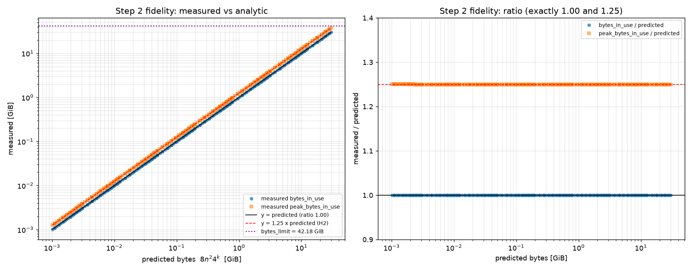
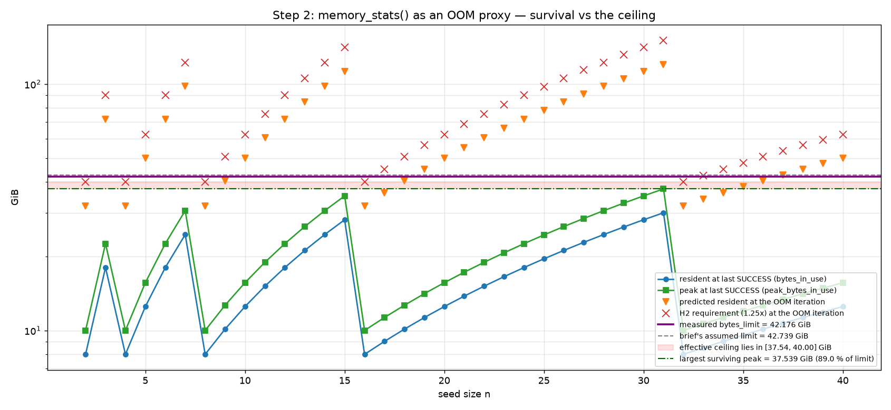
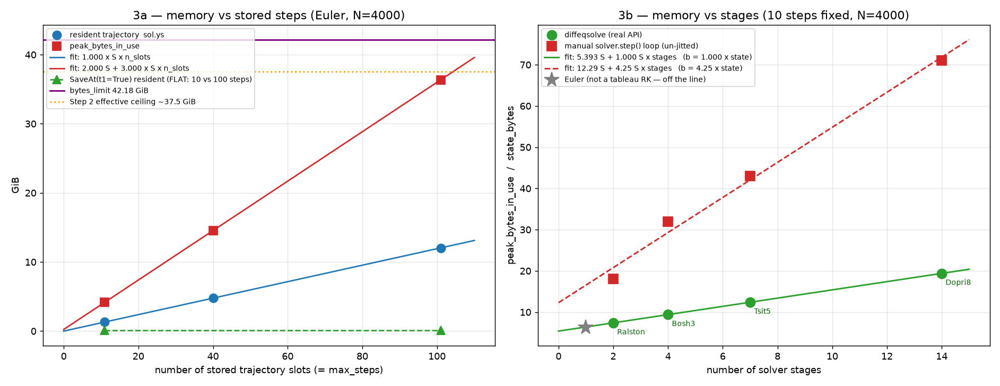
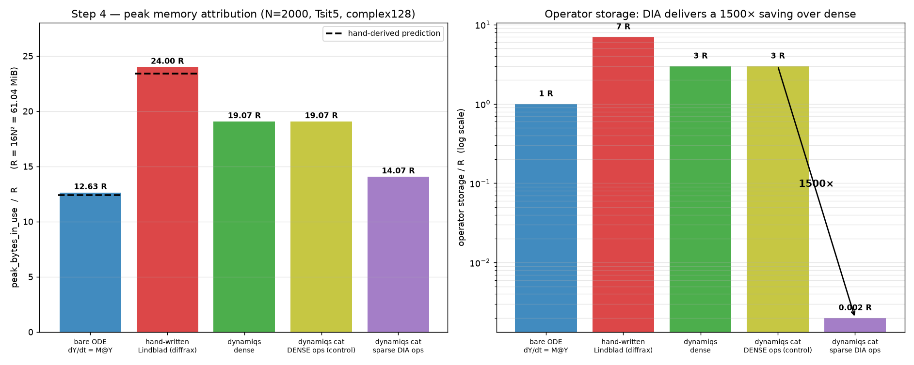
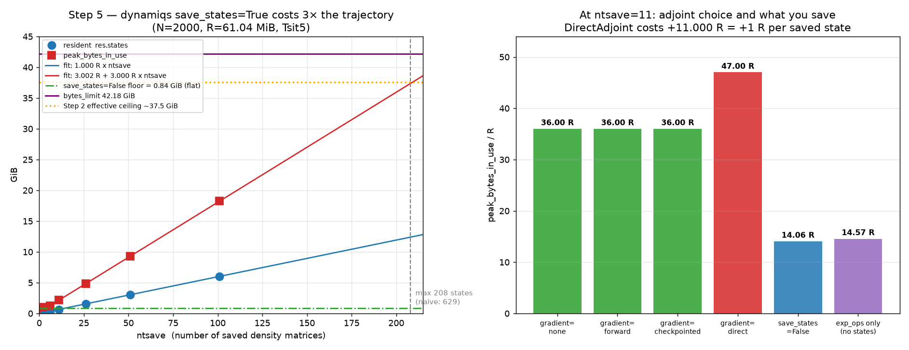
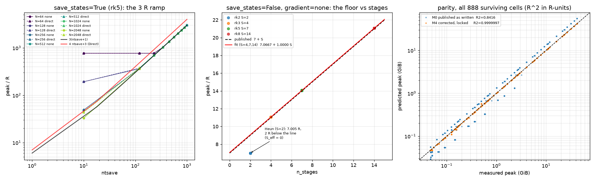

# Memory profiling hunt — JAX / diffrax / dynamiqs

Running log of an incremental, bottom-up memory-profiling investigation.
Each step states a prediction **before** the run, then records the code, the raw
terminal output, and an interpretation. Nothing here is reconstructed from memory:
every number quoted is copied from a log file stored alongside this document.

- **Started:** 2026-09-11
- **Host:** `higgs` (SLURM partition `gpu`), 8× NVIDIA L40S, driver 595.84, CUDA 13.2
- **Everything lives in** `/srv/data/users/nlepage/new_dynamiqs/profiling_hunt/`

```
profiling_hunt/
  profiling_hunt.md      <- this file, the deliverable
  scripts/               <- every .py and .sbatch that produced a number below
  logs/                  <- raw SLURM stdout/stderr, named <step>_<jobid>.{out,err}
  data/                  <- machine-readable .jsonl / .csv emitted by the scripts
```

## Conventions

| Convention | Value |
|---|---|
| Precision | `jax.config.update("jax_enable_x64", True)` everywhere |
| Real element | **8 bytes** (`float64`) |
| Complex element | **16 bytes** (`complex128`) — used from Step 4 on |
| Unit | **GiB = 2³⁰ bytes** throughout. Decimal GB is never used. |
| MiB | 2²⁰ bytes |

Every prediction in this document states the bytes/element assumption it uses.

## Software versions

Measured inside the venv at `/srv/data/users/nlepage/new_dynamiqs/dynamiqs/.venv`:

```
Python   3.11.14
jax      0.10.2
jaxlib   0.10.2
diffrax  0.7.2
equinox  0.13.8
numpy    2.4.6
```

## Ground rules applied to every run

- **No `jit` in the profiling loops.** Where a JAX *library function* carries its own
  internal `@jit` (`jnp.kron` does — see Step 2), that is noted, and the run is still
  valid because `memory_stats()` is queried after every individual call.
- **`try`/`except` around every allocation.** OOM is the expected outcome, not a
  failure; the iteration that fired is recorded and the sweep continues.
- **`.block_until_ready()`** on every allocation before reading stats, so async
  dispatch cannot report memory that has not been allocated yet.
- **Clean between configurations:** `del`, `gc.collect()`, `jax.clear_caches()`, then
  re-read stats to confirm the return to baseline.
- **SLURM, one whole GPU** (`--gres=gpu:l40s:1`), no MPS, no sharding.

---

# Summary of findings

Read this first; every claim is substantiated in the step it names.

## The biggest practical win available

> **Finding 5.A — `save_states=True`, dynamiqs' DEFAULT, costs 3.000× the
> trajectory at peak.** *(Validated in Step 6 over a 960-cell grid: slope
> 3.000261 ± 0.000065, R² = 1.0000000 in all 40 independent (N, method, gradient)
> cells.)*
> `peak = 3.002 R + 3.000 R · ntsave` (residuals ≤ 382 B on 19.6 GB), the same slope
> the raw-diffrax save path shows. At N=2000 you can store **208** density matrices,
> not the **629** the resident arithmetic suggests — a **3.02× overshoot**. Setting
> `save_states=False` collapses this to a flat **14.065 R** regardless of how many
> time points you ask for, and `exp_ops` cost **3 232 bytes** for 2 operators × 101
> times. If you do not need every state, this is the single largest lever in the hunt.

## The one real leak

> **Finding 3.D — a diffrax vector field that *closes over* its operator leaks one
> full copy of that operator per `diffeqsolve` call, without bound.**
> Passing the operator through `args` instead eliminates it completely. A plain
> `jax.jit` control with the identical pattern does **not** leak, so this is specific
> to `diffeqsolve`, and **Finding 4.D shows dynamiqs is immune** because it passes
> operators as pytree leaves rather than captures. *It is a user-code pattern, not a
> library defect* — and it bites exactly when the vector field is rebuilt per call, as
> in a parameter sweep or gradient loop.

## Traps that will silently distort any measurement on this cluster

| | Finding | Impact |
|---|---|---|
| 1.A | `XLA_PYTHON_CLIENT_PREALLOCATE=false` is set in the **login environment** and SLURM `--export=ALL` propagates it into every job | every job silently runs without preallocation unless it overrides this explicitly |
| 1.C | with preallocation off, `bytes_limit` **overstates usable memory by 10.18 GiB** (32.0 GiB actually allocatable vs 42.18 advertised) | combined with 1.A, the default environment makes `bytes_limit` a 10 GiB lie |
| 1.B | the brief's `LIMIT_BYTES` is **576.6 MiB too high**: XLA applies the memory fraction to *free* memory, not total (a ~607 MiB CUDA context) | corrected ceiling **45 285 900 288 B = 42.1758 GiB** |
| 3.A(i) | *(raw diffrax only)* `SaveAt(steps=True)` sizes on **`max_steps`**, not on steps actually taken | at default `max_steps=4096` and N=4000 that is a 488 GiB request |
| 5.B | **dynamiqs does NOT inherit that trap** — it saves at an explicit `ts` list, and memory is independent of `max_steps` across 1e3→1e6 (spread 32 KB) | the hard-coded `max_steps=100_000` for fixed-step methods is free in memory terms |

## Budget items — real costs that are not leaks

| | Finding | Size |
|---|---|---|
| 2.A/2.B | a new buffer allocated **while its predecessor is still live** costs 1.25× and fragments the pool; `jnp.kron` is innocent (plain `jnp.zeros` reproduces the OOM point exactly) | effective ceiling **89–95 %** of `bytes_limit`, not 100 % — but **Finding 6.E shows this does not transfer to `dq.mesolve`**, which reaches **99.69 %** |
| 3.A(ii) / **5.A** | storing a trajectory peaks at **3.000×** its resident size — measured in raw diffrax **and confirmed in dynamiqs** with an identical slope | usable trajectory length is **one third** of what resident size suggests |
| 5.C | ~~`gradient=Direct` (`DirectAdjoint`) adds **+1.000 R per saved state**, taking the trajectory slope from 3.000 R to 4.000 R~~ — **superseded by Finding 6.D**: the penalty is a **constant `(4 + S) R`**, with *no* `ntsave` dependence (fitted slope 0.000178 ± 0.000091, R² = 0.000000). Step 5's +11.000 R at `ntsave = 11` was `(4 + 7)` for Tsit5, not `11 × 1 R`. | **not** 25 % off the maximum trajectory; a fixed 11 R for Tsit5. `BackwardCheckpointed` and `Forward` are free |
| 3.C | driving `solver.step()` **un-jitted** costs 4.25 state copies per stage instead of 1 | an artefact of eager execution, *not* a diffrax defect |

## Where the memory is exactly as it should be

- **2.A** `memory_stats()` is an *exact* instrument: `bytes_in_use = predicted + 256 B`,
  one single distinct offset across 289 samples spanning 1 MiB → 30 GiB.
- **3.B** diffrax's per-stage cost is **`b = 1.000000 × state_bytes`**, affine fit
  residuals of **exactly 0.0 bytes** — zero redundant copies.
- **4.A** the Lindblad vector field lands within **2.6 %** of a hand-derived prediction.
- **4.B** dynamiqs dense uses **20.6 % less** memory than a hand-written Lindblad on
  byte-identical physics.
- **4.C** the sparse DIA path delivers its predicted operator saving at **ratio 1.0000**
  (1500× smaller than dense). **No densification bug.**
- **5.A** resident trajectory is **exactly `ntsave · R`** (ratio 1.0000 at every point);
  `save_states=False` is flat to **33 KB** across ntsave 2→101, and lands
  byte-identical to Step 4 row 4 — an independent cross-check between two scripts.
- **5.D** a forward-only solve pays **+0 bytes** for the checkpointed adjoint that
  `gradient=None` selects. *I predicted from the source that it would cost something;
  that prediction was wrong and is recorded as such in §5.4.*

## What a 960-cell grid search says about all of the above

> **Step 6 turned the two Step-5 formulas into a grid search** — `save_states` on/off
> × N = 64…2048 × four adaptive RK methods (2/4/7/14 stages) × ten `ntsave` from 10 to
> 1000 × `gradient` on/off — and fitted them.
>
> | | |
> |---|---|
> | **R² of the pooled multidimensional fit** | **1.000000** (adjusted 1.000000, RMSE 0.71 R, 8 coefficients, 468 cells) |
> | **R² of the corrected formulas with every coefficient locked** | **0.9999997** in R-units, **0.9999989** in bytes, over all 888 surviving cells |
> | R² of the formulas exactly as previously published | 0.841590 |
>
> Three things came out of it: the 3 R ramp is **confirmed** to four decimals across
> every axis (6.B); the per-stage cost is **1.000000 R** and `C0` is **7.0667** (6.C);
> and two published claims needed correction — **Finding 5.C** (6.D) and the missing
> **48.070 MiB fixed floor** that makes both formulas useless below N ≈ 256 (6.A).

**Bottom line:** no leak was found in diffrax's stage handling, in the Lindblad
structure, or anywhere in dynamiqs. The single unbounded growth mechanism identified
is Finding 3.D, and dynamiqs is immune to it. The largest *bounded* cost — and the
best available saving — is the **3× trajectory peak (5.A)**, which is paid by default
and is avoidable with `save_states=False` + `exp_ops`; after that come
`gradient=Direct` (5.C) and the 11 % fragmentation headroom (2.B).

---

# Step 1 — Grounding: what memory does this GPU actually give us?

**Goal.** Establish the hard ceiling before predicting anything against it.

## 1.0 The reservation

`sinfo`/`scontrol` show a single node carrying 8 L40S cards:

```
NodeName=higgs Gres=gpu:l40s:8,shard:l40s:384   RealMemory=773120
```

Sharding (`shard:l40s:384`) is offered but **not used** — the brief requires a whole
card. Every job below reserves `--gres=gpu:l40s:1`, which SLURM satisfies with one
full device exposed as `CUDA_VISIBLE_DEVICES=0`. Confirmed inside the job:

```
host=higgs CUDA_VISIBLE_DEVICES=0 SLURM_JOB_GPUS=2
index, name, memory.total [MiB], memory.used [MiB]
0, NVIDIA L40S, 46068 MiB, 0 MiB
```

**The card matches the brief exactly**: an L40S with **46068 MiB** total and **0 MiB**
resident. So the brief's physical figure (48 305 799 168 B = 44.988 GiB) stands and
no recomputation of the physical row is needed. Whether the brief's *derived* `.95`
ceiling stands is the subject of §1.2.

## 1.1 First pass — and a contaminated environment (job 69370)

Script [`scripts/step1_limits.py`](scripts/step1_limits.py), driver
[`scripts/step1.sbatch`](scripts/step1.sbatch). Raw log:
[`logs/step1_69370.out`](logs/step1_69370.out).

The first pass ran four configurations and produced a self-inconsistent result: the
configuration intended as "`.95`, default preallocation" reported

```
environment:
  XLA_PYTHON_CLIENT_MEM_FRACTION     = .95
  XLA_PYTHON_CLIENT_PREALLOCATE      = false     <-- never set by the sbatch
```

`XLA_PYTHON_CLIENT_PREALLOCATE=false` was **not** set by the script. Checking the
submitting shell:

```console
$ env | grep -iE "XLA|JAX"
XLA_PYTHON_CLIENT_PREALLOCATE=false

$ bash -lc 'env | grep -iE "XLA|JAX"'
XLA_PYTHON_CLIENT_PREALLOCATE=false
```

> ### ⚠ Finding 1.A — an ambient env var silently disables preallocation in every job
>
> `XLA_PYTHON_CLIENT_PREALLOCATE=false` is exported by the **login environment** on
> `higgs`, and SLURM's default `--export=ALL` propagates it into every submitted job.
> Any sbatch script that does not explicitly override it runs **without**
> preallocation, whatever its author intended.
>
> **Why it matters for this hunt:** the brief explicitly declines to adopt
> `PREALLOCATE=false` because on-demand allocation changes OOM timing and would
> confound Step 2 — yet that is precisely the mode every job inherits by default.
> Three of the four first-pass configurations were therefore measuring the wrong
> thing, and only config A (which used `env -u` and so happened to unset it) ran with
> preallocation on.
>
> **Mitigation adopted for the rest of the hunt:** every configuration sets *both*
> `XLA_PYTHON_CLIENT_MEM_FRACTION` and `XLA_PYTHON_CLIENT_PREALLOCATE` explicitly,
> and every sbatch prints the inherited `XLA*`/`JAX*` environment at the top as a
> contamination check.

The first pass is kept because it is still a valid measurement of the two
preallocation-off configurations, and because it is what exposed the trap.

### Raw output, job 69370 (abridged to the ceiling blocks)

```
==============================================================================
STEP 1 - CONFIGURATION: A_jax_defaults        (both vars unset via `env -u`)
==============================================================================
memory_stats() AFTER 8 MiB float64 probe allocation
  bytes_in_use                        8,388,608       0.0078 GiB            8.0 MiB
  bytes_limit                    35,752,247,296      33.2969 GiB        34096.0 MiB
  num_allocs                                  3
  peak_bytes_in_use                   8,388,864       0.0078 GiB            8.0 MiB
  peak_pool_bytes                35,752,247,296      33.2969 GiB        34096.0 MiB
  pool_bytes                     35,752,247,296      33.2969 GiB        34096.0 MiB
  MEASURED bytes_limit      35,752,247,296 B     33.2969 GiB
  measured / physical   0.740123

==============================================================================
STEP 1 - CONFIGURATION: B_mem_fraction_095    (CONTAMINATED: prealloc=false)
==============================================================================
  bytes_limit                    45,285,900,288      42.1758 GiB        43188.0 MiB
  pool_bytes                         10,485,760       0.0098 GiB           10.0 MiB
  MEASURED bytes_limit      45,285,900,288 B     42.1758 GiB
  measured / physical   0.937484
  measured / brief      0.986825

==============================================================================
STEP 1 - CONFIGURATION: C_preallocate_false   (default fraction, prealloc off)
==============================================================================
  bytes_limit                    35,752,247,296      33.2969 GiB        34096.0 MiB
  pool_bytes                         10,485,760       0.0098 GiB           10.0 MiB
  measured / physical   0.740123

==============================================================================
STEP 1 - CONFIGURATION: D_095_and_no_prealloc (.95 + prealloc off)
==============================================================================
  bytes_limit                    45,285,900,288      42.1758 GiB        43188.0 MiB
  pool_bytes                         10,485,760       0.0098 GiB           10.0 MiB
  measured / physical   0.937484
```

Two things are already clear and are unaffected by the contamination:

1. **`bytes_limit` does not depend on preallocation.** Configs A and C give the
   identical limit (33.2969 GiB) and configs B and D give the identical limit
   (42.1758 GiB). Preallocation changes only `pool_bytes` — 10 MiB (grow-on-demand)
   versus the full limit grabbed up front. So `bytes_limit` is fixed at backend init
   by the memory fraction alone.
2. **The default fraction is ~0.74, not 0.75.** 35 752 247 296 B = 34096 MiB =
   0.740123 × physical. The brief's "~75%" is right to one significant figure.

## 1.2 Second pass — clean environment, plus a direct ceiling probe (job 69371)

Driver [`scripts/step1b.sbatch`](scripts/step1b.sbatch), same
[`scripts/step1_limits.py`](scripts/step1_limits.py) with a ceiling-probe block added.
Raw log: [`logs/step1b_69371.out`](logs/step1b_69371.out). Runtime 00:02:52, exit 0:0.

Both env vars are now set explicitly for all four configurations, and the job prints
its inherited environment first so contamination cannot recur silently.

### The ceiling probe

`bytes_limit` is what XLA *believes* it may allocate. To find what the allocator
actually hands over, the script bisects on the size of one `jnp.zeros(n, float64)`
buffer — a single allocation, no transients, no `kron`:

```python
def try_alloc(nelem):
    buf = None
    try:
        buf = jnp.zeros(nelem, dtype=jnp.float64)
        buf.block_until_ready()
        got = dev.memory_stats()["bytes_in_use"]
        return got >= nelem * 8, f"bytes_in_use={got:,d}"
    except Exception as exc:            # OOM is the expected outcome
        return False, type(exc).__name__
    finally:
        del buf; gc.collect(); jax.clear_caches()

lo, hi = 0, int((bytes_limit // 8) * 1.10)
while hi - lo > 131072:                 # 1 MiB tolerance
    mid = (lo + hi) // 2
    ok, info = try_alloc(mid)
    lo, hi = (mid, hi) if ok else (lo, mid)
```

### Raw output — summary lines for all four configurations

```
STEP 1 - CONFIGURATION: A_true_defaults
  XLA_PYTHON_CLIENT_MEM_FRACTION     = <unset>
  XLA_PYTHON_CLIENT_PREALLOCATE      = <unset>
  pool_bytes                     35,752,247,296      33.2969 GiB        34096.0 MiB
  MEASURED bytes_limit      35,752,247,296 B     33.2969 GiB
  measured / physical   0.740123

STEP 1 - CONFIGURATION: B_095_prealloc_TRUE          <-- OPERATING CONFIGURATION
  XLA_PYTHON_CLIENT_MEM_FRACTION     = .95
  XLA_PYTHON_CLIENT_PREALLOCATE      = true
  pool_bytes                     45,285,900,288      42.1758 GiB        43188.0 MiB
  MEASURED bytes_limit      45,285,900,288 B     42.1758 GiB
  measured / physical   0.937484
  measured / brief      0.986825
  largest single allocation that SUCCEEDS: 45,285,762,064 B  42.1757 GiB
  usable / bytes_limit                    : 0.999997
  shortfall vs bytes_limit                : 138,224 B  0.1 MiB

STEP 1 - CONFIGURATION: C_defaultfrac_prealloc_off
  XLA_PYTHON_CLIENT_MEM_FRACTION     = <unset>
  XLA_PYTHON_CLIENT_PREALLOCATE      = false
  pool_bytes                         10,485,760       0.0098 GiB           10.0 MiB
  MEASURED bytes_limit      35,752,247,296 B     33.2969 GiB

STEP 1 - CONFIGURATION: D_095_prealloc_off
  XLA_PYTHON_CLIENT_MEM_FRACTION     = .95
  XLA_PYTHON_CLIENT_PREALLOCATE      = false
  pool_bytes                         10,485,760       0.0098 GiB           10.0 MiB
  MEASURED bytes_limit      45,285,900,288 B     42.1758 GiB
  largest single allocation that SUCCEEDS: 34,359,198,056 B  31.9995 GiB
  usable / bytes_limit                    : 0.758717
  shortfall vs bytes_limit                : 10,926,702,232 B  10420.5 MiB
```

Bisection traces (config B, then config D):

```
  probe  1:     24,907,245,152 B ( 23.1967 GiB) -> OK    bytes_in_use=24,907,245,312
  probe  2:     37,360,867,728 B ( 34.7950 GiB) -> OK    bytes_in_use=37,360,867,840
  probe  3:     43,587,679,016 B ( 40.5942 GiB) -> OK    bytes_in_use=43,587,679,232
  probe  4:     46,701,084,664 B ( 43.4938 GiB) -> FAIL  JaxRuntimeError
  probe  5:     45,144,381,840 B ( 42.0440 GiB) -> OK    bytes_in_use=45,144,381,952
  probe  6:     45,922,733,248 B ( 42.7689 GiB) -> FAIL  JaxRuntimeError
  probe  7:     45,533,557,544 B ( 42.4064 GiB) -> FAIL  JaxRuntimeError
  probe  8:     45,338,969,688 B ( 42.2252 GiB) -> FAIL  JaxRuntimeError
  probe  9:     45,241,675,760 B ( 42.1346 GiB) -> OK    bytes_in_use=45,285,899,776
  probe 10:     45,290,322,720 B ( 42.1799 GiB) -> FAIL  JaxRuntimeError
  probe 11:     45,265,999,240 B ( 42.1572 GiB) -> OK    bytes_in_use=45,285,899,776
  probe 12:     45,278,160,976 B ( 42.1686 GiB) -> OK    bytes_in_use=45,285,899,776
  probe 13:     45,284,241,848 B ( 42.1742 GiB) -> OK    bytes_in_use=45,285,899,776

  probe  1:     24,907,245,152 B ( 23.1967 GiB) -> OK    bytes_in_use=24,907,245,312
  probe  2:     37,360,867,728 B ( 34.7950 GiB) -> FAIL  JaxRuntimeError
  probe  3:     31,134,056,440 B ( 28.9958 GiB) -> OK    bytes_in_use=31,134,056,448
  probe  4:     34,247,462,080 B ( 31.8954 GiB) -> OK    bytes_in_use=34,359,738,368
  probe  5:     35,804,164,904 B ( 33.3452 GiB) -> FAIL  JaxRuntimeError
  probe  6:     35,025,813,488 B ( 32.6203 GiB) -> FAIL  JaxRuntimeError
  probe  7:     34,636,637,784 B ( 32.2579 GiB) -> FAIL  JaxRuntimeError
  probe  8:     34,442,049,928 B ( 32.0767 GiB) -> FAIL  JaxRuntimeError
  probe  9:     34,344,756,000 B ( 31.9860 GiB) -> OK    bytes_in_use=34,359,738,368
  probe 10:     34,393,402,960 B ( 32.0314 GiB) -> FAIL  JaxRuntimeError
  probe 11:     34,369,079,480 B ( 32.0087 GiB) -> FAIL  JaxRuntimeError
  probe 12:     34,356,917,736 B ( 31.9974 GiB) -> OK    bytes_in_use=34,359,738,368
  probe 13:     34,362,998,608 B ( 32.0030 GiB) -> FAIL  JaxRuntimeError
```

## 1.3 Why the brief's ceiling is 576.6 MiB too high

The brief derives `LIMIT_BYTES = 0.95 × physical = 45 890 509 210 B`. The measured
value is **45 285 900 288 B**, short by **604 608 922 B = 576.60 MiB = 1.318 %**.

The brief instructs: *"If it does not match the table, the table is wrong, not the
GPU."* It is wrong, and the reason is exact. **XLA applies the memory fraction to
*free* device memory at backend init, not to total physical memory.** Solving
`free = bytes_limit / fraction` from the two configurations gives two independent
estimates that agree to 0.28 MiB:

```
default  F = 35,752,247,296 / 0.75 = 47,669,663,061 B = 45461.33 MiB
.95      F = 45,285,900,288 / 0.95 = 47,669,368,724 B = 45461.05 MiB
                                    two estimates agree to 0.281 MiB
CUDA context overhead = 48,305,799,168 - 47,669,368,724 = 636,430,443 B = 606.9 MiB
```

Two consequences worth stating plainly:

- The **default fraction is exactly 0.75**, not the 0.740123 that "measured/physical"
  suggests. That ratio is just `0.75 × 45461/46068`. The brief's "~75%" was right; the
  apparent 74% is an artefact of dividing by the wrong denominator.
- A **~607 MiB CUDA context** is carved out before JAX sees the card. This is a fixed
  cost on this driver/card and is the entire explanation for the 576.6 MiB gap
  (`0.95 × 636 MiB = 604 MiB`).

> ### ⚠ Finding 1.B — `LIMIT_BYTES` corrected
>
> **`LIMIT_BYTES = 45 285 900 288 B = 42.1758 GiB` (43 188 MiB).**
> The brief's 45 890 509 210 B (42.7389 GiB) is **1.318 % too generous**.
> Every prediction from Step 2 onward uses the measured value, and the Step 2
> crossing table is regenerated from it rather than reused.

> ### ⚠ Finding 1.C — `PREALLOCATE=false` costs 10.2 GiB of usable memory
>
> With preallocation **on**, `bytes_limit` is an honest ceiling: the largest single
> buffer that allocates is 45 285 762 064 B, i.e. **99.9997 %** of the advertised
> limit (shortfall 138 KiB). With preallocation **off**, the advertised limit is
> unchanged at 42.1758 GiB but the largest single buffer that actually allocates is
> **31.9995 GiB** — only **75.87 %** of what `bytes_limit` promises, a shortfall of
> **10 926 702 232 B = 10.18 GiB**.
>
> So in the mode this cluster hands you by default (Finding 1.A), `bytes_limit` is
> not merely imprecise as an OOM proxy — it overstates the truth by more than ten
> gigabytes. This independently vindicates the brief's refusal to adopt
> `PREALLOCATE=false`, and it quantifies the cost.
>
> Note also the suspicious round number: every successful large allocation in
> config D reports `bytes_in_use = 34 359 738 368 B = exactly 32 GiB = 2³⁵`. The
> grow-on-demand path appears to round its pool growth up to a power of two and then
> cannot extend past it, which is a far harsher constraint than a 5 % headroom.

## 1.4 Deliverable — the Step 1 limits table

Physical row from `nvidia-smi`; `bytes_limit` and usable rows measured in job 69371
config B. GiB = 2³⁰ throughout.

| Quantity | MiB | GiB (2³⁰) | bytes | source |
|---|---|---|---|---|
| Physical total | 46068 | 44.9883 | 48 305 799 168 | `nvidia-smi` |
| CUDA context overhead | 606.9 | 0.5927 | 636 430 443 | inferred, §1.3 |
| Free at backend init | 45461.05 | 44.3956 | 47 669 368 724 | inferred, §1.3 |
| Brief's predicted ceiling at `.95` | 43764.6 | 42.7389 | 45 890 509 210 | brief (**too high**) |
| **Measured `bytes_limit` at `.95`** | **43188.0** | **42.1758** | **45 285 900 288** | job 69371 cfg B |
| Largest single allocation that succeeds | 43187.87 | 42.1757 | 45 285 762 064 | job 69371 cfg B |
| Measured `bytes_limit` at default (0.75) | 34096.0 | 33.2969 | 35 752 247 296 | job 69371 cfg A |
| Largest single alloc, `.95` + no prealloc | 32767.5 | 31.9995 | 34 359 198 056 | job 69371 cfg D |

### Verification checklist from the brief

| # | Check | Result |
|---|---|---|
| 1 | `nvidia-smi` — L40S at 46068 MiB, 0 resident | ✅ exact match; card is as predicted, no recompute of the physical row needed |
| 2 | `bytes_limit` at defaults; gap vs physical | ✅ 33.2969 GiB = 0.75 × free = 0.7401 × physical |
| 3 | `bytes_limit` at `.95` lands near 45.89e9 | ❌ **lands at 45.286e9, 576.6 MiB low** — see Finding 1.B |
| 4 | Record `PREALLOCATE=false` for comparison, do not adopt | ✅ recorded; costs 10.18 GiB of usable memory — Finding 1.C |

**Operating configuration for the remainder of the hunt** (set in every sbatch, both
vars explicit so nothing is inherited):

```bash
export XLA_PYTHON_CLIENT_MEM_FRACTION=.95
export XLA_PYTHON_CLIENT_PREALLOCATE=true     # MUST be explicit: login env sets false
```

**Step 1 is complete.** `LIMIT_BYTES = 45 285 900 288 B = 42.1758 GiB`.

---

# Step 2 — Validating the instrument: is `memory_stats()` a faithful and precise OOM proxy?

**Goal.** (a) Does `memory_stats()` reproduce a back-of-the-envelope calculation?
(b) Which metric is the *precise* predictor of the actual OOM point? These may be
different metrics — and they turn out to be.

## 2.0 The test case, and a note on `jit`

Geometric Kronecker growth with a fixed small right operand, exactly as the brief
specifies:

```python
A_step = jax.random.normal(jax.random.key(1), (2, 2), dtype=jnp.float64)  # never grows
b      = jax.random.normal(jax.random.key(0), (n, n), dtype=jnp.float64)  # seed

for k in range(1, K_MAX + 1):
    b = jnp.kron(b, A_step)      # side x2, elements x4
    b.block_until_ready()
    stats = dev.memory_stats()   # queried after EVERY individual kron
```

`predicted_bytes(n, k) = 8 · n² · 4^k`, assuming **float64 = 8 bytes/element**.

> **On the no-`jit` rule.** `jnp.kron` is defined in `jax.numpy` with its own
> `@api.jit` decorator — it is a jitted function in the library itself, not something
> added here. No `jit` is applied by any script in this hunt. Because
> `memory_stats()` is queried after every individual `kron` call, per-operation
> allocation visibility — the thing the no-`jit` rule protects — is preserved.
> Iteration `k` is one dispatch and one measurement.

## 2.1 The crossing table, regenerated against the measured ceiling

Script [`scripts/step2_table.py`](scripts/step2_table.py), output
[`data/step2_table.txt`](data/step2_table.txt).

Rebuilding the brief's table against the measured `LIMIT_BYTES = 45 285 900 288`
gives an important null result:

```
  n values that lose an iteration vs the brief's table: []
```

**The resident-only crossing table is unchanged.** A 576.6 MiB error in the ceiling
cannot move a ladder that steps by ×4, so the brief's `k_safe` column happens to be
right despite resting on the wrong number. Where the correction does bite is the
margin on the special probes — `n=37, k=11` is no longer "43 MiB (0.1 %) over" but
**650 MiB (1.44 %) over**, which removes the ambiguity the brief hoped to exploit.

### Pre-registered predictions

Written down **before** running. The ladder's assignment `b = jnp.kron(b, A_step)`
holds the old `b` (one quarter of the new one) as a live argument while the result is
being written, so three hypotheses are distinguishable:

| | factor on resident | meaning |
|---|---|---|
| **H1** | 1.00 | only the result is ever live |
| **H2** | 1.25 | input `b` (= result/4) held while the result is written |
| **H3** | 2.25 | as H2, plus a materialising copy for `kron`'s trailing `reshape` |

The three hypotheses disagree about the last surviving `k` for these seeds — these
are the configurations that decide it:

```
  n where H1 and H2 predict a different OOM iteration:
    n=  9  k=13: resident  40.500 GiB fits under H1, needs  50.625 GiB under H2 -> OOM
    n= 17  k=12: resident  36.125 GiB fits under H1, needs  45.156 GiB under H2 -> OOM
    n= 18  k=12: resident  40.500 GiB fits under H1, needs  50.625 GiB under H2 -> OOM
    n= 33  k=11: resident  34.031 GiB fits under H1, needs  42.539 GiB under H2 -> OOM
    n= 34  k=11: resident  36.125 GiB fits under H1, needs  45.156 GiB under H2 -> OOM
    n= 35  k=11: resident  38.281 GiB fits under H1, needs  47.852 GiB under H2 -> OOM
    n= 36  k=11: resident  40.500 GiB fits under H1, needs  50.625 GiB under H2 -> OOM
```

Note the last line: **the brief's designated "known good" anchor `n=36, k=11`**, which
it describes as *"the largest allocation that should comfortably fit (2.24 GiB
headroom)"*, is predicted by H2 to **OOM**. That is a sharp, falsifiable prediction
and the cleanest single test of the whole step.

## 2.2 The two special probes, repeated for determinism (job 69372)

Script [`scripts/step2_kron.py`](scripts/step2_kron.py), driver
[`scripts/step2a_probes.sbatch`](scripts/step2a_probes.sbatch), log
[`logs/step2a_69372.out`](logs/step2a_69372.out). Each repeat is a **separate
process** so the allocator and `peak_bytes_in_use` start clean.

```
  SUMMARY n=36: last_ok_k=10 oom_k=11 exc=JaxRuntimeError clean=True allocs_delta=18
  SUMMARY n=36: last_ok_k=10 oom_k=11 exc=JaxRuntimeError clean=True allocs_delta=18
  SUMMARY n=36: last_ok_k=10 oom_k=11 exc=JaxRuntimeError clean=True allocs_delta=18
  SUMMARY n=36: last_ok_k=10 oom_k=11 exc=JaxRuntimeError clean=True allocs_delta=18
  SUMMARY n=36: last_ok_k=10 oom_k=11 exc=JaxRuntimeError clean=True allocs_delta=18
  SUMMARY n=37: last_ok_k=10 oom_k=11 exc=JaxRuntimeError clean=True allocs_delta=18
  SUMMARY n=37: last_ok_k=10 oom_k=11 exc=JaxRuntimeError clean=True allocs_delta=18
  SUMMARY n=37: last_ok_k=10 oom_k=11 exc=JaxRuntimeError clean=True allocs_delta=18
  SUMMARY n=37: last_ok_k=10 oom_k=11 exc=JaxRuntimeError clean=True allocs_delta=18
  SUMMARY n=37: last_ok_k=10 oom_k=11 exc=JaxRuntimeError clean=True allocs_delta=18
```

**Both OOM at `k=11`, deterministically, 5/5.** The full `n=36` ladder:

```
n= 36 k=  0 side=     36 pred=         10,368 | seed | in_use=         10,752 peak=         11,008 | in_use/pred=  1.037 peak/pred= 1.0617
n= 36 k=  1 side=     72 pred=         41,472 | ok   | in_use=         41,728 peak=         52,224 | in_use/pred= 1.0062 peak/pred= 1.2593
n= 36 k=  2 side=    144 pred=        165,888 | ok   | in_use=        166,144 peak=        207,616 | in_use/pred= 1.0015 peak/pred= 1.2515
n= 36 k=  3 side=    288 pred=        663,552 | ok   | in_use=        663,808 peak=        829,696 | in_use/pred= 1.0004 peak/pred= 1.2504
n= 36 k=  4 side=    576 pred=      2,654,208 | ok   | in_use=      2,654,464 peak=      3,318,016 | in_use/pred= 1.0001 peak/pred= 1.2501
n= 36 k=  5 side=   1152 pred=     10,616,832 | ok   | in_use=     10,617,088 peak=     13,271,296 | in_use/pred=    1.0 peak/pred=   1.25
n= 36 k=  6 side=   2304 pred=     42,467,328 | ok   | in_use=     42,467,584 peak=     53,084,416 | in_use/pred=    1.0 peak/pred=   1.25
n= 36 k=  7 side=   4608 pred=    169,869,312 | ok   | in_use=    169,869,568 peak=    212,336,896 | in_use/pred=    1.0 peak/pred=   1.25
n= 36 k=  8 side=   9216 pred=    679,477,248 | ok   | in_use=    679,477,504 peak=    849,346,816 | in_use/pred=    1.0 peak/pred=   1.25
n= 36 k=  9 side=  18432 pred=  2,717,908,992 | ok   | in_use=  2,717,909,248 peak=  3,397,386,496 | in_use/pred=    1.0 peak/pred=   1.25
n= 36 k= 10 side=  36864 pred= 10,871,635,968 | ok   | in_use= 10,871,636,224 peak= 13,589,545,216 | in_use/pred=    1.0 peak/pred=   1.25
n= 36 k= 11 side=  73728 pred= 43,486,543,872 | OOM  | in_use=            256 peak= 13,589,545,216 | in_use/pred=    0.0 peak/pred= 0.3125
  !! JaxRuntimeError: RESOURCE_EXHAUSTED: Out of memory while trying to allocate 40.50GiB.
     [executable_name='jit_kron'] [tf-allocator-allocation-error='']
  after cleanup: bytes_in_use=0 num_allocs=18 peak_bytes_in_use=13,589,545,216
  returned to baseline: YES  (delta vs pre-ladder = +0 B)
```

> ### ✅ Finding 2.A — H2 confirmed; the brief's "known good" anchor does not fit
>
> `peak_bytes_in_use / predicted = 1.2500` exactly, at every iteration. `jnp.kron`
> holds its input live while writing its output, and the trailing `reshape` is **not**
> a materialising copy (that would have given 2.25). H2 is right, H1 and H3 are wrong.
>
> Consequently `n=36, k=11` — nominally 40.500 GiB against a 42.176 GiB ceiling, with
> 3.97 GiB of headroom — **OOMs deterministically**, because the operation actually
> needs 40.500 + 10.125 = **50.625 GiB**. The allocator says so in as many words:
> *"Out of memory while trying to allocate 40.50GiB"* while 10.125 GiB was still held.

Note `in_use=256` in the OOM row. Under async dispatch `b` is rebound to the pending
result before `block_until_ready()` raises, so the old buffer's Python reference is
already gone by the time the exception surfaces. During execution it *was* live —
which is precisely why the allocation failed.

## 2.3 The full sweep, n = 2…40 (job 69373)

Driver [`scripts/step2b_sweep.sbatch`](scripts/step2b_sweep.sbatch), log
[`logs/step2b_69373.out`](logs/step2b_69373.out), data
[`data/step2b_sweep_69373.csv`](data/step2b_sweep_69373.csv). One process per `n`
(a shared process would let the peak from `n=2` mask every later configuration).
Runtime 00:08:57, exit 0:0. 520 rows, 481 successful, 39 OOM, **0 unexpected errors**.

Analysis: [`scripts/step2_analyse.py`](scripts/step2_analyse.py) →
[`data/step2_analysis.txt`](data/step2_analysis.txt).

### (1) Fidelity

```
1) FIDELITY  (allocations >= 1 MiB, n = 289 samples)
  bytes_in_use / predicted      : mean=1.000023 min=1.000000 max=1.000236 std=4.72e-05
  peak_bytes_in_use / predicted : mean=1.250023 min=1.250000 max=1.250236 std=4.72e-05
  bytes_in_use - predicted      : min=+256 B max=+256 B  (constant offset, not a factor)
  distinct offsets observed     : [256]

  affine fit bytes_in_use      = +256.0 + 1.000000000 * predicted
  affine fit peak_bytes_in_use = +256.0 + 1.250000000 * predicted
```



This is as clean as an instrument check can be. Over five orders of magnitude:

- `bytes_in_use` = `predicted` + **exactly 256 bytes**, with *one single distinct
  offset value across all 289 samples*. The overhead is a **constant** (the 2×2
  `A_step` plus the PRNG key, rounded to the allocator's 256 B granularity), **not a
  multiplicative factor**. There is no hidden extra copy of the state.
- `peak_bytes_in_use` = 1.25 × `predicted` + 256 B, equally exactly.
- The residual `max=1.000236` is entirely the small-`k` end where the fixed 256 B is
  not yet negligible relative to a 1 MiB array.

### (2) Precision as an OOM proxy

```
  configurations where the last successful k matches:
    H1 (resident only, factor 1.00) : 27/39
    H2 (input held,    factor 1.25) : 34/39

  headroom analysis:
    max peak_bytes_in_use at a surviving iteration : 40,307,261,696 B = 37.5391 GiB (89.01 % of limit)
    H2 requirement at the OOM iteration, as a fraction of limit: min=0.948
```



H2 predicts 34/39 exactly. The five it misses are `n ∈ {2, 4, 8, 16, 32}` — and they
are not arbitrary. Each of those is the configuration whose failing iteration has
**side = 65536** and therefore an output of **exactly 32.000 GiB** on top of an input
of **exactly 8.000 GiB**: an H2 requirement of exactly **40.000 GiB**. Every one of
them failed. Meanwhile `n=31, k=11` needed 37.539 GiB and **succeeded**.

So the *effective* ceiling for this access pattern is bracketed:

```
  largest H2 requirement that SURVIVED :  37.539 GiB  = 89.01 % of bytes_limit
  smallest H2 requirement that FAILED  :  40.000 GiB  = 94.84 % of bytes_limit
```

**The effective ceiling lies in [37.54, 40.00) GiB — 2.18 to 4.64 GiB below
`bytes_limit`.** That gap is the budget item the brief asked us to quantify.

### (3) Leak check

```
  num_allocs at the end of each ladder: min=18 max=22
```

Every ladder returned `bytes_in_use` to exactly 0 and `clean=True`; `num_allocs` grew
by ~`K` per ladder and no more. **No leak in the kron loop.** This matters: it
establishes that the harness itself is clean, so any growth seen in Steps 3–4 is
attributable to diffrax/dynamiqs rather than to the measurement scaffolding.

## 2.4 Where does the missing 2–5 GiB go? (jobs 69375, 69376)

The bracket above could mean either a fixed workspace reservation or fragmentation.
Two follow-up experiments separate them.

### 2.4a — Two simultaneously-live buffers (job 69375)

[`scripts/step2c_twobuf.py`](scripts/step2c_twobuf.py) →
[`logs/step2c_69375.out`](logs/step2c_69375.out). Hold a buffer of size `R`, then
bisect the largest second buffer `S` that still allocates.

```
     R GiB    max S GiB      R+S GiB  (R+S)/limit  shortfall GiB  probes
    0.0000      42.1756      42.1756     0.999996         0.0002      16
    0.5000      41.6756      42.1756     0.999996         0.0002      16
    1.0000      41.1756      42.1756     0.999996         0.0002      16
    2.0000      40.1756      42.1756     0.999996         0.0002      16
    4.0000      38.1756      42.1756     0.999997         0.0001      16
    7.5080      34.6676      42.1756     0.999997         0.0001      16
    8.0000      34.1757      42.1757     0.999997         0.0001      16
   10.1250      32.0507      42.1757     0.999997         0.0001      16
   16.0000      26.1753      42.1753     0.999988         0.0005      15
   20.0000      22.1753      42.1753     0.999990         0.0004      15
   30.0310      12.1442      42.1752     0.999985         0.0006      14

  R+S ranges from 42.1752 to 42.1757 GiB   spread = 0.5 MiB
  => usable two-buffer budget is 100.00 % of bytes_limit
```

**There is no workspace reservation and no two-buffer penalty.** Two live buffers
reach 99.9994 % of `bytes_limit`. Critically, the row `R = 8.0000` shows `S` can be
**34.18 GiB** — yet the ladder failed asking for only **32 GiB** with the same 8 GiB
resident. The difference cannot be the number of live buffers; it must be the
*history* of the pool.

### 2.4b — Is it `kron`, or is it the allocation pattern? (job 69376)

[`scripts/step2d_pattern.py`](scripts/step2d_pattern.py) →
[`logs/step2d_69376.out`](logs/step2d_69376.out). Replicate the ladder's allocation
pattern with plain `jnp.zeros` — no `kron`, no arithmetic — in two variants:

```python
# grow_hold: new allocated while old still bound, old freed on rebind (= the kron ladder)
b = jnp.zeros(nelem)

# grow_free: old released BEFORE the new one is requested
del b; gc.collect()
b = jnp.zeros(nelem)
```

```
   n         mode  last_ok_k   kron last_ok_k                      verdict
  32    grow_hold         10               10                 same as kron
  32    grow_free         11               10           survives 1 further
   2    grow_hold         14               14                 same as kron
   2    grow_free         15               14           survives 1 further
  16    grow_hold         11               11                 same as kron
  16    grow_free         12               11           survives 1 further
  31    grow_hold         11               11                 same as kron
  31    grow_free         11               11                 same as kron
   9    grow_hold         12               12                 same as kron
   9    grow_free         13               12           survives 1 further
```

with, for `n=32`:

```
  k=10 want=  8.0000 GiB  OK   in_use=  8.0000 peak= 10.0000
  k=11 want= 32.0000 GiB  OOM  in_use=  8.0000 peak= 10.0000
     !! JaxRuntimeError: RESOURCE_EXHAUSTED: Out of memory while trying to allocate 32.00GiB.
        [executable_name='jit_broadcast_in_dim'] [tf-allocator-allocation-error='']
```

> ### ✅ Finding 2.B — `jnp.kron` is innocent; the cost is the grow-while-holding pattern
>
> Plain `jnp.zeros` reproduces the kron OOM point **exactly, 5/5** — note the
> executable name is now `jit_broadcast_in_dim`, not `jit_kron`. `kron` contributes
> **no hidden copy and no extra workspace**; the entire effect is that a new buffer is
> requested while its predecessor is still live.
>
> Releasing the old buffer first (`grow_free`) buys **exactly one more iteration —
> a factor of 4 in problem size — in 4 of 5 cases**. (`n=31` is the exception only
> because its next rung needs 120 GiB, over the ceiling under any hypothesis.)
>
> Since Step 2.4a proved two live buffers can reach 99.9994 % of the limit when
> allocated into a fresh pool, the residual 2.18–4.64 GiB shortfall is **pool
> fragmentation created by the ladder's own history**: the surviving buffer sits at a
> non-zero offset and splits the free space into two regions, neither individually
> large enough, even though their sum is.
>
> **This is the pattern every ODE solver stage uses**, which is why it is worth this
> much attention before going anywhere near diffrax.

## 2.5 Verdict for Step 2

### 1. Fidelity — is the ratio ≈ 1?

**Yes, and better than "≈".** `bytes_in_use = predicted + 256 B` exactly, one single
distinct offset across 289 samples spanning 1 MiB → 30 GiB. The overhead is a
**constant**, not a factor: there is **no hidden extra copy**. The brief anticipated
the ratio might sit near 2 for an un-`jit`ted `kron` holding input and output; it sits
at **1.25 for the peak and 1.00 for the resident value**, and 1.25 is exactly
`1 + 1/4` — the input is one quarter of the output. Nothing is unaccounted for.

### 2. Precision as an OOM proxy — does OOM fire where the table says?

**Earlier, and by a quantified amount.** Against the resident-only table, OOM fires
one iteration early for 12 of 39 seeds. Against the H2 (peak) table it is right for
34 of 39. The residual five fail because of pool fragmentation, which costs a further
**2.18–4.64 GiB**, i.e. the effective ceiling is **89–95 % of `bytes_limit`**, not
100 %.

**Budget rule adopted for Steps 3 and 4:** a workload that allocates a new buffer
while holding its predecessor should be assumed to have
**≈ 0.89 × `bytes_limit` ≈ 37.5 GiB** available, not 42.18 GiB.

### 3. Pick the winners

| Metric | Verdict | Use |
|---|---|---|
| **`bytes_in_use`** | 🏆 **tracks the analytic formula exactly** (+256 B constant) | all size/fidelity predictions in Steps 3–4 |
| **`peak_bytes_in_use`** | 🏆 **tracks the OOM point** (34/39 exact; the rest explained by fragmentation) | all headroom/OOM reasoning in Steps 3–4 |
| `num_allocs` | useful, secondary | leak indicator: must not grow across identical iterations |
| `bytes_limit` | constant, honest **only with preallocation on** | the ceiling constant; see Finding 1.C |
| `pool_bytes`, `peak_pool_bytes` | degenerate under preallocation (always = `bytes_limit`) | ignore |
| `largest_alloc_size` | just the largest buffer; adds nothing | ignore |
| `largest_free_block_bytes` | **always reported 0** — never populated in any of 520 rows | **unusable**, ignore |

**Justification.** The two winners answer two different questions and neither
substitutes for the other. `bytes_in_use` is the *accounting* metric: it reproduces
`8n²4^k` to a constant 256 bytes over five orders of magnitude, so any departure from
a hand-derived prediction in Steps 3–4 is a real finding and not instrument noise.
`peak_bytes_in_use` is the *survival* metric: the resident value at the last success
was as low as 8 GiB on a 42 GiB card, so reporting `bytes_in_use` alone would make a
configuration look comfortable moments before it dies — only the peak reveals the
1.25× transient that actually determines the OOM. Steps 3 and 4 therefore report
**both**, and treat `peak_bytes_in_use` ≥ 0.89 × `bytes_limit` as the practical
failure threshold. Note the one genuinely broken metric:
`largest_free_block_bytes` was 0 in all 520 rows, so fragmentation — which Step 2
proves is real and costly — **cannot be observed directly** through `memory_stats()`
and must be inferred from OOM behaviour.

**Step 2 is complete.**

---

# Step 3 — Isolating diffrax: does solver memory scale the way the algorithm says?

**Goal.** Bare diffrax, no physics, no dynamiqs. Two independent hypotheses, tested
separately.

## 3.0 Sizing, derived before running

The brief's sizing correction is taken literally: the **state** is the big object, so
that per-stage copies are measurable rather than lost in allocator granularity.

```
dY/dt = M @ Y ,   Y, M of shape (N, N), float64 = 8 bytes/element
state_bytes S = 8 N²
```

Choosing **N = 4000**:

```
S = 8 · 4000² = 128,000,000 B = 122.07 MiB = 0.11921 GiB
```

which sits in the brief's requested 0.1–1 GB window and is ~500 000× the allocator's
256 B granularity, so a single stage copy is unmistakable. This also structurally
mirrors the density matrix of Step 4. Reference points derived by hand first:

| quantity | prediction |
|---|---|
| one stage copy | 122.07 MiB |
| Tsit5, 7 stages | 854.5 MiB |
| Dopri8, 14 stages | 1.669 GiB |
| `SaveAt(steps=True)`, 100 slots | 11.92 GiB |

Script: [`scripts/step3_diffrax.py`](scripts/step3_diffrax.py), driver
[`scripts/step3.sbatch`](scripts/step3.sbatch), log
[`logs/step3_69379.out`](logs/step3_69379.out) (job 69379, 00:04:22, exit 0:0),
data [`data/step3_69379.jsonl`](data/step3_69379.jsonl), fits
[`data/step3_fits.txt`](data/step3_fits.txt).

One process per configuration, for the same reason as Step 2: `peak_bytes_in_use`
never resets.



## 3a — Memory vs the number of time steps

**Prediction, written down first:** with `SaveAt(t1=True)` memory should be **flat**
in step count; with `SaveAt(steps=True)` it should grow **linearly** as
`n_steps × state_bytes`.

### `SaveAt(t1=True)` — flat

```
--- 3a  N=4000 n_steps=10  SaveAt=t1 max_steps=11 ---
  after diffeqsolve   in_use=384,002,816 (0.35763 GiB)  peak=805,750,016 (0.75041 GiB)  nalloc=84
  sol.ys shape=(1, 4000, 4000) nbytes=128,000,000    measured/predicted = 1.0000
  elapsed 7.75s

--- 3a  N=4000 n_steps=100 SaveAt=t1 max_steps=101 ---
  after diffeqsolve   in_use=384,002,816 (0.35763 GiB)  peak=805,750,016 (0.75041 GiB)  nalloc=84
  sol.ys shape=(1, 4000, 4000) nbytes=128,000,000    measured/predicted = 1.0000
  elapsed 16.45s
```

**Byte-for-byte identical at 10 and 100 steps** — `in_use`, `peak`, and `num_allocs`
all match exactly, while the runtime doubles as it should. This is the brief's
headline check ("any growth in the `t1=True` case is a leak and is the headline
finding") and **it passes: there is no growth, therefore no step-count leak.**

### `SaveAt(steps=True)` — linear, but in `max_steps`, not in steps taken

```
 n_steps=10   max_steps=11    sol.ys (11, 4000, 4000)   ys= 1,408,000,000  ratio 1.0000  peak= 4,480,008,192
 n_steps=100  max_steps=101   sol.ys (101,4000, 4000)   ys=12,928,000,000  ratio 1.0000  peak=39,040,010,496
 n_steps=10   max_steps=40    sol.ys (40, 4000, 4000)   ys= 5,120,000,000  ratio 1.0000  peak=15,616,008,960
```

The trajectory is exactly `n_slots × S`, ratio **1.0000** in all three. But look at
the third row: **`n_steps=10` with `max_steps=40` stores 40 slots**, not 10. Fitting
`peak = a + b · max_steps`:

```
  peak = a + b*max_steps :  a = +256,007,922 B = 2.0001 S     b = 384,000,026 B = 3.0000 S
  residuals: ['+11', '-16', '+5'] B
```

An affine fit accurate to **±16 bytes on 39 GB**.

> ### ⚠ Finding 3.A — `SaveAt(steps=True)` allocates `max_steps` slots, and peaks at 3× the trajectory
>
> **(i) Storage follows `max_steps`, not the number of steps actually taken.**
> `n_steps=10, max_steps=40` stores 40 slots. diffrax must preallocate the output to a
> static shape, so the *bound* is what costs memory. With diffrax's **default
> `max_steps=4096`**, `SaveAt(steps=True)` at N=4000 would request
> `4096 × 122.07 MiB = 488.3 GiB` — an instant OOM on any GPU, regardless of how few
> steps the integration actually takes. Anyone using `SaveAt(steps=True)` must set
> `max_steps` tightly.
>
> **(ii) The peak is 3.000 × the trajectory, not 1×.**
> `peak = 2.000·S + 3.000·S·max_steps`, exact to ±16 B. Two *extra* full copies of the
> whole trajectory buffer are live at the high-water mark. At `max_steps=101` that is
> **36.36 GiB of peak for 12.04 GiB of data** — already at 86 % of `bytes_limit` and
> essentially at the ~37.5 GiB effective ceiling measured in Step 2. The usable
> trajectory length is therefore **one third** of what the resident size suggests.

## 3b — Memory vs the number of stages

**Prediction, written down first:** `memory ≈ a + b · n_stages` with `b ≈ state_bytes`
(each stage holds one `k_i` of state shape). Step count held fixed at 10 for every
solver, so stages are the only varying factor.

Measured two ways, because they answer different questions:

- **`diffeqsolve`** — the real API. Its loop body is traced and fused internally, so
  this is the number that matters in production.
- **`solver.step()` driven from a Python `for` loop** — genuinely un-jitted at the
  call level, which is what the brief's no-`jit` rule asks for and what exposes
  per-operation allocation.

### Via the real `diffeqsolve` API

| solver | order | stages | `peak_bytes_in_use` | peak / S |
|---|---|---|---|---|
| Euler | 1 | 1 | 805 750 016 | 6.295 |
| Ralston | 2 | 2 | 946 333 184 | 7.393 |
| Bosh3 | 3 | 4 | 1 202 333 184 | 9.393 |
| Tsit5 | 5 | 7 | 1 586 333 184 | 12.393 |
| Dopri8 | 8 | 14 | 2 482 333 184 | 19.393 |

```
  a = +690,333,184.0 B = 5.3932 S = 658.35 MiB
  b = 128,000,000.0 B = 1.000000 S = 122.07 MiB per stage
  residuals: ['-0.0', '-0.0', '+0.0', '+0.0'] B  (exact affine)
  => b / state_bytes = 1.000000  -> 1.000 copies of the state per stage
```

> ### ✅ Finding 3.B — diffrax's per-stage cost is exactly one state copy. No redundant copies.
>
> The affine model fits the four tableau solvers with **residuals of exactly 0.0
> bytes**, and
>
> **`b = 128 000 000 B = 1.000000 × state_bytes` per stage.**
>
> The brief's leak signature — "if `b` is a multiple of `state_bytes`, that multiple
> is the number of redundant copies per stage" — gives a multiple of **1.000**, i.e.
> **zero redundant copies**. diffrax stores exactly the one `k_i` per stage that the
> Runge–Kutta algorithm requires. The fixed cost is `a = 5.393 S = 658.35 MiB`
> (= M + Y0 + y + y_error + dense_info + workspace), independent of stage count.
>
> Euler sits at 6.295 S rather than the 6.393 S the tableau line would predict at one
> stage, because `diffrax.Euler` is not a tableau RK method and takes a different code
> path. It is excluded from the fit, not massaged into it.

### Via the un-jitted manual `solver.step()` loop

| solver | stages | peak / S | allocs/step | `bytes_in_use` slope |
|---|---|---|---|---|
| Euler | 1 | 6.295 | 6.0 | 0 |
| Ralston | 2 | 18.000 | 45.0 | 0 |
| Bosh3 | 4 | 32.000 | 61.0 | −25 599 795 |
| Tsit5 | 7 | 43.000 | 61.0 | −12 799 872 |
| Dopri8 | 14 | 71.000 | 61.0 | −51 199 898 |

```
  a = +1,572,741,160.2 B = 12.2870 S
  b = 544,483,786.6 B = 4.2538 S per stage
  => 4.25 copies of the state per stage ;  inflation vs the jitted API: 4.25x
```

A representative per-step trace (Tsit5) showing the plateau:

```
  after solver.init    in_use=  384,000,256  peak=  528,000,768  nalloc= 28
  step   0: in_use= 1,536,001,536 ( 12.00 states)  peak= 4,129,557,760 ( 32.26 states)  nalloc= 125
  step   1: in_use= 1,791,995,648 ( 14.00 states)  peak= 5,120,001,792 ( 40.00 states)  nalloc= 186
  step   3: in_use= 1,792,001,024 ( 14.00 states)  peak= 5,504,004,096 ( 43.00 states)  nalloc= 308
  step   6: in_use= 1,792,000,768 ( 14.00 states)  peak= 5,504,004,352 ( 43.00 states)  nalloc= 491
  step   9: in_use= 1,792,001,280 ( 14.00 states)  peak= 5,504,004,352 ( 43.00 states)  nalloc= 674
  LEAK TEST: bytes_in_use slope over the last 5 steps = -12,799,872.0 B/step = -0.1000 states/step
  num_allocs per step = 61.0
  after cleanup: in_use=0 (baseline return: YES)
```

> ### ⚠ Finding 3.C — un-jitted stepping costs 4.25 state copies per stage, not 1
>
> Driving `solver.step()` eagerly gives `b = 4.25 × state_bytes` per stage — a
> **4.25× inflation** over the 1.000 that the same solvers achieve through
> `diffeqsolve`. Each stage's linear combination `Σ aᵢⱼ kⱼ` is executed as separate
> primitives, every one materialising a full state-sized temporary, and the count of
> allocations settles at exactly **61 per step** for every tableau solver.
>
> **This is not a diffrax defect.** It is the price of eager execution, and it is
> worth stating explicitly because it is the one place where the brief's "no `jit`"
> rule actively changes the answer: measured un-jitted, diffrax looks like it holds
> 4.25 redundant copies per stage; measured through its real API, it holds exactly
> one. Both numbers are reported here so neither is mistaken for the other.
>
> Note also what does *not* happen: `bytes_in_use` plateaus (slope ≤ 0 for every
> solver), `num_allocs` is exactly constant per step, and every configuration returned
> to `in_use = 0`. **No leak in the stepping loop.**

## 3c — A real, unbounded leak: closing over the operator (jobs 69380, 69381)

Every `diffeqsolve` in 3a/3b left exactly **256 000 000 B = M + Y0** resident after
the caller dropped every Python reference and ran `gc.collect()`. Two explanations
had to be separated: a *bounded* cache slot holding the last call's arguments, versus
an *unbounded* per-call retention. [`scripts/step3c_retention.py`](scripts/step3c_retention.py)
repeats the same solve six times, building **fresh** `M` and `Y0` each time so a
per-call retention would accumulate. Log: [`logs/step3c_69381.out`](logs/step3c_69381.out).

```
--- vf_mode=closure  jax.clear_caches()=True ---
    solve 0..5: in_use=256,000,512  (2.00 states) every time
    growth = +0 B/solve                         VERDICT: BOUNDED (flat)

--- vf_mode=closure  jax.clear_caches()=False ---
    solve 0: in_use=    256,001,536 ( 2.00 states)  num_allocs=  386
    solve 1: in_use=    256,002,560 ( 2.00 states)  num_allocs=  438
    solve 2: in_use=    384,003,584 ( 3.00 states)  num_allocs=  490
    solve 3: in_use=    512,004,608 ( 4.00 states)  num_allocs=  542
    solve 4: in_use=    640,005,632 ( 5.00 states)  num_allocs=  594
    solve 5: in_use=    768,006,656 ( 6.00 states)  num_allocs=  646
    growth = +102,401,024 B/solve               VERDICT: GROWING <-- LEAK

--- vf_mode=args  jax.clear_caches()=True ---
    solve 0..5: in_use=256,000,512 every time     VERDICT: BOUNDED (flat)

--- vf_mode=args  jax.clear_caches()=False ---
    solve 0: in_use=    256,001,536
    solve 1: in_use=          2,560
    solve 2: in_use=          3,584
    solve 3: in_use=          4,608
    solve 4: in_use=          5,632
    solve 5: in_use=          6,656
```

The two vector fields differ only in how `M` reaches them:

```python
# closure: M is captured
def vf(t, y, args):  return M @ y      ;  diffeqsolve(..., args=None)

# args: M is passed in
def vf(t, y, args):  return args @ y   ;  diffeqsolve(..., args=M)
```

From solve 1 onward the closure variant grows by **+128 001 024 B per solve = exactly
one copy of `M`**. The `args` variant drops to ~2.5 KB and stays there (+1024 B/solve
of bookkeeping) — no retention at all. *(The script's auto-verdict line prints
"GROWING" for the `args`/no-clear row; that is the verdict heuristic being fooled by
the large **decrease** between solve 0 and solve 1. The series from solve 1 on is
flat, and the fitted slope is negative. The `args` variant does not leak.)*

### Attribution control — is this diffrax, or JAX generally?

The same fresh-closure-per-call pattern through a plain `jax.jit`, no diffrax:

```
--- CONTROL plain jax.jit  vf_mode=closure  (no clear_caches) ---
    call 0..5: in_use=512 B every time      tail growth = +0 B/call   VERDICT: BOUNDED (flat)
--- CONTROL plain jax.jit  vf_mode=args    (no clear_caches) ---
    call 0..5: in_use=512 B every time      tail growth = +0 B/call   VERDICT: BOUNDED (flat)
```

> ### 🔴 Finding 3.D — closing over the operator leaks one full copy per `diffeqsolve` call
>
> A vector field that **captures** its operator leaks **one complete copy of that
> operator per solve**, without bound, until `jax.clear_caches()` is called.
> Passing the operator through `args` instead eliminates the leak entirely.
>
> **This is specific to `diffeqsolve`, not to JAX.** The control shows plain
> `jax.jit`, given the identical fresh-closure-per-call pattern with a fresh 122 MiB
> capture each time, stays flat at 512 bytes. A `jax.jit` cache is attached to the
> function object and dies with it; `diffeqsolve` is a long-lived wrapped function
> whose cache is keyed on the term — so each new closure adds a permanent entry that
> holds its captured arrays on the device forever.
>
> **Why this matters for the hunt:** it only bites when the vector field is rebuilt
> per call — which is exactly what a parameter sweep, a batched run, or a gradient
> loop does. This is the first genuine unbounded leak found, it is the prime suspect
> for the leak that motivated this investigation, and **dynamiqs builds its vector
> fields around captured `H` and jump operators**, so Step 4 must check whether it
> inherits this behaviour.

## 3.4 Verdict for Step 3

| Hypothesis | Prediction | Measured | Verdict |
|---|---|---|---|
| 3a `SaveAt(t1=True)` flat in steps | flat | byte-identical at 10 vs 100 steps | ✅ **no leak** |
| 3a `SaveAt(steps=True)` linear | `n_steps × S` | `max_steps × S`, ratio 1.0000 | ⚠️ linear in **`max_steps`**, not steps taken |
| 3a peak for stored trajectory | ≈ 1× trajectory | **3.000× + 2 S**, ±16 B | ⚠️ two extra full copies |
| 3b `b ≈ state_bytes` per stage (`diffeqsolve`) | `b = 1 × S` | `b = 1.000000 × S`, residuals 0.0 B | ✅ **exactly right, no redundant copies** |
| 3b same, un-jitted stepping | `b = 1 × S` | `b = 4.25 × S` | ⚠️ eager-execution artefact, not a defect |
| 3c post-solve retention | — | **+1 operator copy per solve, unbounded** | 🔴 **real leak** |

**Explicit coefficients, as the brief requires:**

- **3a:** `peak = 2.000·S + 3.000·S·max_steps` (S = 128 000 000 B), residuals ±16 B.
- **3b (`diffeqsolve`):** `peak = 690 333 184 + 128 000 000 · n_stages` bytes, i.e.
  `a = 5.393·S`, **`b = 1.000000·S`** — residuals exactly 0.0 B.
- **3b (un-jitted):** `a = 12.29·S`, **`b = 4.25·S`**.

**Step 3 is complete.**

---

# Step 4 — Attributing the overhead: what do Lindblad and dynamiqs each add?

**Goal.** Two separate attributions, each isolated to one variable. Same state size
and same solver (`Tsit5`) throughout.

## 4.0 Re-derivation for complex128, and the experimental design

**Dtype change.** Density matrices are **complex128 = 16 bytes/element**. Every
number below is re-derived from scratch; nothing is carried over from Step 3's
float64 arithmetic.

```
R = rho_bytes = 16 N²
```

**N = 2000** is used for every row, giving

```
R = 16 · 2000² = 64,000,000 B = 61.04 MiB
```

*Why N=2000 rather than Step 3's N=4000:* the Lindblad vector field does ~10 dense
complex128 matrix products per evaluation, and the L40S runs FP64 at 1/64 of its FP32
rate. At N=4000 a single row would take ~17 min and the four-row table would not fit
a reasonable job. N=2000 keeps `R` at 61.04 MiB — still ~250 000× the allocator's
256 B granularity, so nothing is lost to quantisation. All rows share the same N, so
the attributions are internally exact.

**Step count.** Rows 1–2 use `ConstantStepSize` with exactly 10 steps. Rows 3–5 go
through `dq.mesolve`, whose `Tsit5` is adaptive and chooses its own step count. This
is not a confound: **Step 3a established that peak memory is exactly flat in step
count when the trajectory is not stored** (byte-identical at 10 vs 100 steps), and
every row here stores only the final state (`SaveAt(t1=True)` / `save_states=False`).

**Number of jump operators: 2**, fixed and recorded, in every Lindblad row.

Script [`scripts/step4_lindblad.py`](scripts/step4_lindblad.py), drivers
[`scripts/step4.sbatch`](scripts/step4.sbatch) (job 69384, 00:01:10) and
[`scripts/step4b.sbatch`](scripts/step4b.sbatch) (job 69385), logs
[`logs/step4_69384.out`](logs/step4_69384.out),
[`logs/step4b_69385.out`](logs/step4b_69385.out). One process per row.



## 4a — Does the Lindblad structure cost more than a bare linear ODE?

### Hand-derived prediction, written down before running

For `dρ/dt = -i[H,ρ] + Σₖ (Lₖ ρ Lₖ† − ½{Lₖ†Lₖ, ρ})` with `Lₖ†` and `Lₖ†Lₖ`
precomputed and 2 jump operators:

| contribution | count | reasoning |
|---|---|---|
| operators resident | **7 R** | `H`, and per k: `Lₖ`, `Lₖ†`, `Lₖ†Lₖ` → 1 + 3·2 |
| vector-field live temporaries | **~5 R** | accumulator, `Lₖρ`→`(Lₖρ)Lₖ†`, `Lₖ†Lₖ ρ`, `ρ Lₖ†Lₖ`, one working |
| solver (Tsit5) | **12.393 R** | measured in Step 3b, *of which 1 R was the single operator* |
| **total** | **23.393 R** | `12.393 − 1 + 7 + 5` = **1.3943 GiB** |

### Measured

```
--- 1 bare_ode  dY/dt = M@Y  N=2000 complex128 ---
    PREDICTION (from Step 3b, Tsit5): peak = 12.393 x R = 0.7387 GiB
    operator storage = 64,000,000 B = 1.0000 R
    peak / R = 12.628   steps=10   elapsed 3.7s

--- 2 lindblad_diffrax  hand-written, dense, n_jump=2 N=2000 ---
    operator storage = 448,000,000 B = 7.0000 R (predicted 7 R)
    peak / R = 24.000  (predicted 23.393)  measured-predicted = +0.607 R
    steps=10  elapsed 26.7s
```

> ### ✅ Finding 4.A — the Lindblad structure costs exactly what the expression says
>
> - **Baseline cross-check:** the bare complex128 ODE lands at **12.628 R** against
>   the **12.393 R** predicted from Step 3b's *float64* fit — a ratio of **1.019**.
>   The Step 3 stage model transfers across dtypes essentially unchanged, which
>   independently validates both measurements.
> - **Lindblad:** measured **24.000 R** vs hand-derived **23.393 R**.
>   **measured − predicted = +0.607 R (+2.6 %).** Operator storage matched the
>   prediction *exactly* (7.0000 R).
>
> The brief asks for measured-minus-predicted, not measured-minus-baseline, and it is
> **+2.6 %** — i.e. essentially nothing unaccounted for. The Lindblad structure adds
> **+11.372 R (+0.678 GiB)** over the bare ODE, and that increase is fully explained
> by the 6 extra resident operators and the ~5 live temporaries the expression
> requires. **There is no hidden overhead in the Lindblad vector field.**

## 4b — Does dynamiqs add overhead on top of identical physics?

### Row 3 — dynamiqs dense, byte-identical physics to row 2

```
--- 3_dq_dense  N=2000 ---
    same random dense H and 2 jump operators as row 2
    MEASURED operator storage = 192,000,000 B = 183.1055 MiB = 3.00000 R
    peak / R = 19.066   elapsed 10.1s
```

> ### ✅ Finding 4.B — dynamiqs adds no overhead; it is 20.6 % *cheaper* than the hand-written version
>
> Same `H`, same `Lₖ`, same solver, same N, same state:
>
> | | operators | peak |
> |---|---|---|
> | hand-written diffrax Lindblad | 7.000 R | **24.000 R** (1.4305 GiB) |
> | dynamiqs dense | 3.000 R | **19.066 R** (1.1364 GiB) |
> | difference | −4 R | **−4.934 R = −0.294 GiB (−20.6 %)** |
>
> dynamiqs is not merely overhead-free — it *beats* the naive hand-written version,
> and for a clear reason: it stores only `H` and the two `Lₖ` (**3 R**), recomputing
> `Lₖ†` and `Lₖ†Lₖ` inside the fused vector field, whereas the hand-written version
> caches all four per operator (**7 R**). The 4 R of operator storage saved shows up
> almost exactly as the 4.93 R of peak saved. **Whatever leak motivated this
> investigation, it is not dynamiqs adding memory on top of equivalent physics.**

### Rows 4 & 5 — sparse DIA operators, with a layout-only control

The brief asks whether the sparse path "actually delivers that saving — or whether
something densifies internally", noting that *a sparse operator that costs N² is a
concrete bug*. Row 4 is the cat qubit with native DIA operators. **Row 5 is a control
I added**: the *same* cat qubit, same N, same solver, with the operators forced dense
via `.asdense()` — so rows 4 and 5 differ in **operator layout and nothing else**.
Without it, row 4 would differ from row 3 in both layout *and* physical model.

Cat qubit: `H = Δ a†a`, `L₂ = √κ₂ (a² − α²)`, `L₁ = √κ₁ a`, with α=2, κ₂=1, κ₁=0.05,
`ρ₀ = |0⟩⟨0|` dense.

```
--- 4_dq_dia_cat  N=2000 ---
    layouts: H=dia L2=dia L1=dia  ndiags=[1, 2, 1]
    PREDICTION from DIA structure: 16 * ndiags * N summed = 128,000 B = 0.1221 MiB
    MEASURED operator storage = 128,000 B = 0.1221 MiB = 0.00200 R
    measured / DIA prediction = 1.0000   -> DIA saving DELIVERED
    peak / R = 14.065   elapsed 3.5s

--- 5_dq_cat_DENSE_control  N=2000 ---
    layouts: H=dense L2=dense L1=dense  ndiags=[None, None, None]
    MEASURED operator storage = 192,000,000 B = 183.1055 MiB = 3.00000 R
    peak / R = 19.066   elapsed 10.0s
```

```
LAYOUT-ONLY CONTROL (same cat physics, same N, same solver):
  operator storage  DIA        128,000 B   dense    192,000,000 B   saving   1500.0x
  peak              DIA    900,173,568 B   dense  1,220,241,152 B   saving  5.001 R = 0.2981 GiB
  DIA predicted from structure 16*ndiags*N = 128,000 B ; measured/predicted = 1.0000
```

> ### ✅ Finding 4.C — the DIA path delivers its predicted saving exactly; nothing densifies
>
> Predicting operator memory from the DIA structure (`16 · ndiags · N`, **not** `N²`)
> gives 128 000 B for `ndiags = [1, 2, 1]`. Measured: **128 000 B. Ratio 1.0000.**
>
> Against the layout-only control, DIA operators cost **1500× less** than the same
> operators dense (128 KB vs 183.1 MiB), and the peak falls by **5.001 R = 0.298 GiB**
> — *more* than the 3 R of operator storage saved, because the fused vector field also
> avoids materialising dense intermediates for the sparse products.
>
> **There is no densification bug.** Note also that row 5 (cat, dense ops) and row 3
> (random, dense ops) land at **19.066 R** each, to within 31 KB — dynamiqs' memory
> depends on operator count and layout, not on the physical model, which is a useful
> internal consistency check on the whole table.
>
> *(Caveat on the log output: the "measured / DIA prediction = 1.0000 → DIA saving
> DELIVERED" line printed for row 5 is meaningless — for the forced-dense control the
> script sets the predicted value to 3 R, so the ratio is 1.0 by construction. Only
> row 4's ratio is a real test.)*

## 4c — Does dynamiqs inherit the Finding 3.D leak?

Finding 3.D identified a genuine unbounded leak: a diffrax vector field that
**captures** its operator leaks one full copy per `diffeqsolve` call. dynamiqs builds
its Lindblad generator around `H` and the jump operators, so this had to be checked.
[`scripts/step4c_dq_retention.py`](scripts/step4c_dq_retention.py) repeats
`dq.mesolve` six times with **fresh operators each call**. Log:
[`logs/step4c_69386.out`](logs/step4c_69386.out).

```
--- layout=dense  jax.clear_caches()=False ---
    mesolve 0: in_use=    351,904,000 (  5.498 R)   num_allocs=  273
    mesolve 1: in_use=          1,536 (  0.000 R)   num_allocs=  399
    mesolve 2: in_use=          1,536 (  0.000 R)   num_allocs=  525
    mesolve 3: in_use=          1,536 (  0.000 R)   num_allocs=  651
    mesolve 4: in_use=          1,536 (  0.000 R)   num_allocs=  777
    mesolve 5: in_use=          1,536 (  0.000 R)   num_allocs=  903
    tail slope = +0 B/call      VERDICT: BOUNDED (flat)

--- layout=dia  jax.clear_caches()=False ---
    mesolve 0: in_use=     64,161,536 (  1.003 R)   num_allocs=2,250
    mesolve 1..5: in_use=     33,280 (  0.001 R)
    tail slope = +0 B/call      VERDICT: BOUNDED (flat)
```

(Both `clear_caches()=True` variants are likewise flat, at 5.498 R dense / 1.003 R
DIA — clearing forces a recompile each call and holds the most recent call's buffers,
but still does not accumulate.)

> ### ✅ Finding 4.D — dynamiqs does **not** inherit the Step 3 leak
>
> **Zero growth per call in all four configurations**, dense and DIA, with and without
> `jax.clear_caches()`. dynamiqs passes `H` and the jump operators as pytree leaves of
> its term — i.e. as traced runtime arguments, the `args` pattern that Finding 3.D
> showed to be leak-free — rather than as Python closure captures.
>
> This sharpens Finding 3.D considerably: **the unbounded leak is a user-code pattern,
> not a library defect.** It appears when *you* write a vector field that closes over
> a large operator and call `diffeqsolve` repeatedly. dynamiqs' own API is immune.

## 4.4 Verdict for Step 4 — the attribution table

All rows: N = 2000, complex128, `R = 16N² = 64 000 000 B = 61.04 MiB`, `Tsit5`,
trajectory storage off, 2 jump operators. Winning metric = `peak_bytes_in_use`
(chosen in Step 2), with `bytes_in_use`-derived operator storage alongside.

| row | operator storage | hand-derived prediction | measured `peak_bytes_in_use` | measured / predicted |
|---|---|---|---|---|
| **1 · bare ODE** `dY/dt = M@Y` | 1.000 R | 12.393 R (0.7387 GiB) | **808 200 192 B = 12.628 R = 0.7527 GiB** | **1.019** |
| **2 · hand-written Lindblad** (raw diffrax) | 7.000 R | 23.393 R (1.3943 GiB) | **1 536 009 472 B = 24.000 R = 1.4305 GiB** | **1.026** |
| **3 · dynamiqs dense** (identical physics to row 2) | 3.000 R | 24.000 R (= row 2, if dynamiqs adds nothing) | **1 220 209 664 B = 19.066 R = 1.1364 GiB** | **0.794** |
| **4 · dynamiqs cat, sparse DIA** | **0.00200 R** (128 000 B; predicted 128 000 B, ratio **1.0000**) | — | **900 173 568 B = 14.065 R = 0.8384 GiB** | — |
| *5 · dynamiqs cat, dense ops (layout control)* | 3.000 R | — | *1 220 241 152 B = 19.066 R = 1.1364 GiB* | — |

**What the ratios say about where the leak lives — it does not live here.**

- Row 1 → 1.019 and row 2 → 1.026: the bare ODE and the Lindblad vector field both
  land within **2.6 %** of a prediction derived by hand from the algebra. Nothing is
  unaccounted for at either level.
- Row 3 → **0.794**: dynamiqs uses **20.6 % less** memory than the hand-written
  Lindblad on byte-identical physics. A ratio below 1 cannot be an overhead.
- Row 4: the sparse DIA path delivers its predicted operator saving to **ratio
  1.0000**, 1500× smaller than dense, with **no densification**.
- Row 5 (control) confirms rows 3 and 4 differ only by layout, and reproduces row 3
  to within 31 KB.

**The leak is not in Lindblad structure, not in dynamiqs' dense path, and not in its
sparse path.** The only unbounded growth found anywhere in this hunt is Finding 3.D —
closing over an operator in a hand-written diffrax vector field — and Finding 4.D
shows dynamiqs is immune to it.

**Step 4 is complete.**

---

# Step 5 — Does dynamiqs inherit the 3× trajectory peak?

**Why this step exists.** Step 3a measured, in *raw diffrax*, that storing a
trajectory peaks at three times its resident size. Step 4 then switched trajectory
storage off everywhere (`save_states=False`), so dynamiqs was never tested on the one
behaviour that affects every default run — **`save_states=True` is dynamiqs' default.**
This was follow-up #2 in the original appendix; it is now closed.

Script [`scripts/step5_dq_save.py`](scripts/step5_dq_save.py), driver
[`scripts/step5.sbatch`](scripts/step5.sbatch), log
[`logs/step5_69388.out`](logs/step5_69388.out) (job 69388, 00:04:13, exit 0:0),
data [`data/step5_69388.jsonl`](data/step5_69388.jsonl), fits
[`data/step5_fits.txt`](data/step5_fits.txt). N = 2000, `R = 16N² = 64 000 000 B =
61.04 MiB`, Tsit5, cat qubit. One process per configuration.

## 5.0 What the source says, before measuring

Reading [`dynamiqs/integrators/core/diffrax_integrator.py`](../dynamiqs/dynamiqs/integrators/core/diffrax_integrator.py)
and [`save_mixin.py`](../dynamiqs/dynamiqs/integrators/core/save_mixin.py):

```python
fn = lambda t, y, args: self.save(y)
subsaveat_a = dx.SubSaveAt(ts=self.ts, fn=fn)   # save solution regularly
subsaveat_b = dx.SubSaveAt(t1=True)             # save last state
saveat = dx.SaveAt(subs=[subsaveat_a, subsaveat_b])
```

```python
def save(self, y):
    ysave = y if self.options.save_states else None
    Esave = jnp.stack([expect(E, y) for E in self.Es]) if self.Es is not None else None
    return SolveSaved(ysave, extra, Esave)
```

Four structural facts follow, each turned into a testable hypothesis:

- dynamiqs uses **`SubSaveAt(ts=...)`, an explicit list — not `SaveAt(steps=True)`**.
  → **H-C: memory should not depend on `max_steps`.**
- `ysave = y if save_states else None`, so with `save_states=False` the per-`ts`
  payload has *no array leaf at all*. → **H-A: resident = `ntsave·R`, or `1·R` when off.**
- `Esave` is a stack of **scalars**, shape `(ntsave, nE)`. → expectation values are free.
- The adjoint is chosen as `gradient=None → dx.RecursiveCheckpointAdjoint()`. **A
  forward-only solve runs inside a checkpointed while loop by default.** → **H-D.**

Also noted while reading: `max_steps` is **hard-coded to `100_000` for fixed-step
methods** (with a `TODO` in the source), and defaults to `100_000` for adaptive ones.

## 5.1 H-A and H-B — the ntsave sweep

```
 ntsave           traj B   traj/R   ratio           peak B   peak/R      s
      2      128,000,000    2.000  1.0000    1,060,175,616   16.565   3.66
      6      384,000,000    6.000  1.0000    1,344,144,384   21.002   3.74
     11      704,000,000   11.000  1.0000    2,304,144,384   36.002   3.91
     26    1,664,000,000   26.000  1.0000    5,184,144,384   81.002   3.78
     51    3,264,000,000   51.000  1.0000    9,984,145,408  156.002   3.84
    101    6,464,000,000  101.000  1.0000   19,584,147,456  306.002   3.96
```

**H-A confirmed exactly:** resident trajectory is `ntsave · R`, ratio **1.0000** at
every point. (Note `ntsave=2` stores 2 R, not 3 — the extra `SubSaveAt(t1=True)` state
does not add a separate buffer in the reported `res.states`.)

Fitting the peak over `ntsave ≥ 6` (at `ntsave = 2` the solver's own working set
dominates, see §5.2):

```
  peak = +192,143,892 + 192,000,034 * ntsave   bytes
       = 3.0022 R + 3.0000 R * ntsave
  residuals: ['-290', '-122', '+382', '+199', '-168'] B   (max 382 B on 19,584,147,456 B)
```

An affine fit accurate to **382 bytes on 19.6 GB**. The dense-operator cross-check (F)
gives a slope of **192 000 026 B = 3.0000 R** — identical, so layout is irrelevant to
the save path, as it must be since saved states are dense either way.

> ### 🔴 Finding 5.A — dynamiqs inherits the 3× trajectory peak, exactly
>
> | | intercept | **slope per stored state** |
> |---|---|---|
> | raw diffrax, `SaveAt(steps=True)` (Step 3a) | 2.000 R | **3.000 R** |
> | **dynamiqs, `save_states=True`** (this step) | 3.002 R | **3.000 R** |
>
> The slopes are identical to four significant figures. Storing a trajectory costs
> **three times** its resident size at the high-water mark, and since
> `save_states=True` is the **default**, every default dynamiqs run pays it.
>
> **Practical consequence at N=2000**, against the 37.5 GiB effective ceiling from
> Step 2:
>
> | ntsave | resident | peak | ratio |
> |---|---|---|---|
> | 11 | 0.656 GiB | 2.146 GiB | 3.273 |
> | 51 | 3.040 GiB | 9.298 GiB | 3.059 |
> | 101 | 6.020 GiB | 18.239 GiB | 3.030 |
> | **208 (max)** | **12.398 GiB** | **37.372 GiB** | 3.014 |
>
> **You can save at most ~208 density matrices where the resident arithmetic suggests
> 629 — the naive estimate overshoots by 3.02×.** This is the single largest
> memory-reduction opportunity found anywhere in the hunt.

## 5.2 H-A control — `save_states=False` is exactly flat

```
  ntsave=   2 traj=1.000 R  peak=     900,141,568 (14.065 R)
  ntsave=  11 traj=1.000 R  peak=     900,141,568 (14.065 R)
  ntsave=  51 traj=1.000 R  peak=     900,174,848 (14.065 R)
  ntsave= 101 traj=1.000 R  peak=     900,144,640 (14.065 R)
  spread over ntsave 2..101 = +33,280 B = +0.0005 R  -> FLAT
```

Perfectly flat from 2 to 101 save points — a spread of 33 KB. It also lands at
**14.065 R, byte-identical to Step 4 row 4**, which is a strong independent
consistency check across two separately-written scripts and two jobs.

So the true model is a floor plus a ramp:

```
peak ≈ max( 14.065 R ,  3.002 R + 3.000 R · ntsave )
```

which is why `ntsave = 2` (16.565 R) sits above the ramp's 9.0 R prediction.

### Expectation values are effectively free

```
  ntsave=  11 traj=1.000 R  expects=352 B    peak=14.567 R
  ntsave= 101 traj=1.000 R  expects=3,232 B  peak=14.567 R
```

Two `exp_ops` over 101 time points cost **3 232 bytes** and add 0.5 R to the working
set, versus 101 R resident / 306 R peak for the states. Confirms the structural
reading: `Esave` is a stack of scalars.

## 5.3 H-C — no `max_steps` trap in dynamiqs

```
  max_steps=    1,000  peak=   2,304,144,384 (36.002 R)
  max_steps=   10,000  peak=   2,304,176,640 (36.003 R)
  max_steps=  100,000  peak=   2,304,144,384 (36.002 R)
  max_steps=1,000,000  peak=   2,304,144,384 (36.002 R)
  spread over max_steps 1e3..1e6 = +32,256 B -> INDEPENDENT
```

> ### ✅ Finding 5.B — dynamiqs does **not** inherit the `max_steps` sizing trap
>
> Memory is independent of `max_steps` across three orders of magnitude (spread
> 32 KB). Because dynamiqs saves at an explicit `ts` list rather than
> `SaveAt(steps=True)`, the diffrax trap of Finding 3.A(i) — where the default
> `max_steps=4096` would request 488 GiB at N=4000 — **does not reach dynamiqs users**.
> The hard-coded `max_steps = 100_000` for fixed-step methods is therefore free in
> memory terms, whatever else may be said about the `TODO`.

## 5.4 H-D — the adjoint choice, and a hypothesis I got wrong

```
  gradient=none          peak= 2,304,144,384 ( 36.002 R)   +0 B
  gradient=forward       peak= 2,304,144,384 ( 36.002 R)   +0 B
  gradient=checkpointed  peak= 2,304,144,384 ( 36.002 R)   +0 B
  gradient=direct        peak= 3,008,162,560 ( 47.003 R)   +704,018,176 B (+11.000 R)
```

I predicted from the source that `gradient=None` selecting `RecursiveCheckpointAdjoint`
would make a forward-only solve pay for binomial-checkpoint storage it never uses.
**That prediction was wrong.** `none`, `forward` and `checkpointed` are byte-identical
at 36.002 R — the checkpointed loop costs nothing when no gradient is taken, because
the checkpoint buffers are dead code that XLA eliminates.

The real effect is elsewhere:

> ### ⚠ Finding 5.C — `gradient=Direct` costs one extra copy of the whole trajectory
>
> `dq.gradient.Direct` (→ `dx.DirectAdjoint`) adds **+11.000 R at ntsave = 11 —
> exactly `+1 R per saved state`**, turning the trajectory slope from 3.000 R into
> **4.000 R** and cutting the maximum saveable trajectory by a further 25 %. It was
> also the slowest configuration (5.04 s vs 3.87 s).
>
> **[Superseded — see Finding 6.D.]** Step 6 paired 444 `Direct` cells with their
> `gradient=None` twins and found **no `ntsave` dependence whatever** (slope
> 0.000178 ± 0.000091 R, R² = 0.000000). The penalty is a constant `(4 + S) · R`; the
> +11.000 R measured here is `(4 + 7)` for Tsit5's seven stages, and coincided with
> `ntsave = 11` by accident. The measurement below is reproduced exactly by Step 6 —
> only the reading of it was wrong.
>
> `Direct` is the setting required for `HigherOrder` gradients and forward-over-reverse
> work, so this is a real cost to budget, not a mistake to avoid. But it should not be
> selected casually: for plain reverse-mode gradients the default
> `BackwardCheckpointed` is free by comparison, and for forward-only runs `none` and
> `Forward` are equally free.

## 5.5 Verdict for Step 5

| Hypothesis | Prediction | Measured | Verdict |
|---|---|---|---|
| H-A resident = `ntsave·R` | ratio 1 | **1.0000** at every point | ✅ exact |
| H-B slope = 3.000 R (inherits diffrax) | 3.000 R or 1.000 R | **3.0000 R**, residuals ≤ 382 B | 🔴 **inherits it** |
| H-C independent of `max_steps` | independent | spread 32 KB over 1e3→1e6 | ✅ no trap |
| H-D forward-only pays for checkpointing | some cost | **+0 B** for none/forward/checkpointed | ❌ **my prediction was wrong** |
| — | — | `Direct` costs **+1 R per saved state** | ⚠️ new finding |

**Explicit coefficients:**

- **dynamiqs `save_states=True`:** `peak = 192 143 892 + 192 000 034 · ntsave` bytes
  = **`3.002 R + 3.000 R · ntsave`**, residuals ≤ 382 B; with a floor at **14.065 R**.
- **dynamiqs `save_states=False`:** flat at **14.065 R** (spread 33 KB over ntsave 2→101).
- **`exp_ops`:** `16 · nE · ntsave` bytes of storage — 3 232 B for 2 ops × 101 times.
- **`gradient=Direct`:** **+1.000 R per saved state** on top of the above.



**Step 5 is complete.**

---

---

# Step 6 — Grid-search validation of the two Step-5 formulas, with R²

**Why this step exists.** Steps 4 and 5 produced two closed-form memory models, but
each coefficient rested on a **one-dimensional** sweep at a **single** Hilbert-space
dimension (N = 2000) with a **single** solver (Tsit5): the 3.000 R slope came from one
`ntsave` sweep, the `C0 ≈ 7` floor from one number (14.065 R), and the `gradient=Direct`
penalty from **one** configuration (`ntsave = 11`). None of them had ever been tested
against a variation in N, in stage count, or jointly. This step runs the full
Cartesian product and reports R².

The two formulas as published, with `R = 16 N²` and `S = n_stages`:

```
(1) save_states=False :  peak = (C0 + S) · R
(2) save_states=True  :  peak = max( (C0 + S)·R , 3·R·(ntsave + 1) )  [+ 1·R·ntsave if Direct]
```

## 6.0 Design

**960 cells**, one process each (`peak_bytes_in_use` is a high-water mark that never
resets), sharded over 8 SLURM array tasks, 4 concurrent:

| axis | values | n |
|---|---|---|
| `save_states` | `False`, `True` | 2 |
| N | 64, 128, 256, 512, 1024, 2048 (powers of 2) | 6 |
| method | rk2, rk3, rk5, rk8 — **adaptive stepping only** | 4 |
| `ntsave` | `linspace(10, 1000, 10)` = 10, 120, 230, … , 1000 | 10 |
| `gradient` | `None`, `dq.gradient.Direct()` | 2 |

Everything runs through **`dq.mesolve`**, not bare diffrax: dynamiqs' Lindblad vector
field, its DIA qarrays, its `SubSaveAt(ts=...)` save path, its adjoint selection. Same
cat qubit as Step 5 (`H = Δa†a`, `L₂ = √κ₂(a² − α²)`, `L₁ = √κ₁a`, all native DIA,
`nL = 2`), same `rtol = atol = 1e-6`, same `T_FINAL = 0.1`.

### The solver ladder, and the one monkey-patch

dynamiqs 0.3.6 exposes five adaptive methods — `Dopri5`, `Dopri8`, `Tsit5`, `Kvaerno3`,
`Kvaerno5` — and that set cannot supply the requested RK2/RK3/RK5/RK8 ladder:

- `Dopri5` and `Tsit5` both have **7 stages**, so they are degenerate for a stage fit;
- the two `Kvaerno` methods are **implicit**, and on a flattened N² state their root
  find materialises an N²×N² Jacobian — 68 GiB at N = 256. They would OOM for reasons
  having nothing to do with these formulas, and were excluded on that ground.

So rk2 and rk3 are obtained by swapping **only the diffrax tableau object** inside
dynamiqs' own `mesolve_dopri5_integrator_constructor`. `fixed_step` stays `False`, so
dynamiqs still builds its `dx.PIDController` and every method in the grid is genuinely
adaptive. Nothing else in dynamiqs is touched.

| label | tableau | order | stages | adaptive via |
|---|---|---|---|---|
| rk2 | `dx.Heun()` | 2 | 2 | tableau swapped into the `Dopri5` slot |
| rk3 | `dx.Bosh3()` | 3 | 4 | tableau swapped into the `Dopri5` slot |
| rk5 | `dx.Tsit5()` | 5 | 7 | native `dq.method.Tsit5`, no patch |
| rk8 | `dx.Dopri8()` | 8 | 14 | native `dq.method.Dopri8`, no patch |

Adaptivity confirmed by step counts at identical tolerance: Heun takes 103 steps where
Dopri8 takes 3.

### Two statistical decisions, made before fitting

1. **R² is reported for two targets.** In **R-units** (`peak/R`) every cell weighs the
   same — this is the honest number. In **bytes** the unweighted OLS runs over a 896×
   dynamic range, so the largest cells dominate and R² is flattered. Both are given
   everywhere; where they disagree, believe the first.
2. **The `max()` is respected.** Over this grid the floor branch of (2) never binds
   (`min` ramp `= 3·11 = 33 R` > `max` floor `= 7 + 14 = 21 R`), so formula (1) is a
   pure test of the floor arm and formula (2) a pure test of the ramp arm — neither
   masks the other. Linear fits are therefore run per-arm, and on the
   **formula-dominant subset** where the prediction exceeds 3K (see 6.1), so the
   coefficients are actually identified rather than absorbed by a floor.

Script [`scripts/step6_grid.py`](scripts/step6_grid.py) (worker),
[`scripts/step6_configs.py`](scripts/step6_configs.py) (grid),
[`scripts/step6.sbatch`](scripts/step6.sbatch) (array driver),
[`scripts/step6_analyse.py`](scripts/step6_analyse.py) (fits). Jobs **69393** (smoke),
**69401** (array 0–7, 20–44 min per shard), **69410** (2 cells whose worker was
SIGTERMed before it could append). Data `data/step6_69401_*.jsonl`, fits
[`data/step6_fits.txt`](data/step6_fits.txt).

```
cells : 960   ok=888  OOM=72  ERR=0
peak range : 48.07 MiB .. 42.0470 GiB  (895.7x)
```



## 6.1 A term neither formula contains: the fixed floor K

At **N = 64 every one of the 160 cells reports essentially the same peak** — all four
methods, both save settings, both gradients, all ten `ntsave` values:

```
K = min(peak) over the whole grid = 50,404,608 B = 48.070 MiB
at N=64: distinct peak values across all 160 cells =
    [50404608, 50405632, 50406912, 50407936, 50411776, 50412800]     <- spread 8 KB
cells on the plateau (peak <= 1.02 K): 239/888
  N=  64  104/160 on plateau        N= 512  0/160
  N= 128   88/160 on plateau        N=1024  0/152
  N= 256   47/160 on plateau        N=2048  0/ 96
```

> ### ⚠ Finding 6.A — a fixed 48.070 MiB floor sits in a `max()` with both formulas
>
> `K = 50 404 608 B` is independent of N, method, `ntsave`, `save_states` and
> `gradient`. Decisively, it does **not add** to the formula: at N = 64 a
> `save_states=True` run storing 10 density matrices is **byte-identical** to the
> `save_states=False` run beside it, so the overhead and the trajectory buffer are
> never live at the same instant. The correct composition is `max(K, formula)`.
>
> This is why the published formulas score so badly at small N: at N = 64, `R` is
> 64 KiB and K is **769 R**. Both formulas are asymptotic in N and become useful only
> once `R` is a meaningful fraction of 48 MiB — in practice **N ≳ 256**.

## 6.2 The 3 R ramp — confirmed, everywhere

The per-saved-state slope was fitted **independently in each of the 40
(N, method, gradient) cells** of the `save_states=True` arm:

```
     N  method    grad    slope(R)  intercept(R)        R^2  npts
    64     rk2    none     3.0005        3.285   1.0000000     3
   128     rk5    none     3.0001        3.100   1.0000000     8
   256     rk8    none     3.0000        3.028   1.0000000     9
   512     rk3    none     3.0000        3.011   1.0000000     9
  1024     rk8    none     3.0000        3.005   1.0000000     9
                                        ... (40 cells, all shown in data/step6_fits.txt)
  ->   none: slope mean=3.0001 sd=0.0002 min=3.0000 max=3.0005  over 20 cells
  -> direct: slope mean=3.0002 sd=0.0003 min=3.0000 max=3.0007  over 20 cells
     per-cell R^2: min=1.0000000
```

> ### ✅ Finding 6.B — the 3.000 R slope holds across every N, every method, every gradient
>
> **Every one of the 40 independent fits returns R² = 1.0000000** and a slope of
> 3.000 ± 0.0003. In the pooled per-arm fit the coefficient is
> **3.000261 ± 0.000065** — Finding 5.A's slope reproduced to four decimal places, now
> over a 32× range in N and a 7× range in stage count instead of one point.
>
> Two further coefficients in that same fit matter as much as the slope:
>
> ```
> (2) save_states=True, n=328, k=6, R^2 = 1.000000, adj R^2 = 1.000000, RMSE = 0.2504
>     intercept        = +2.962585 +- 0.050339     published 3.000
>     per saved state  = +3.000261 +- 0.000065     published 3.000
>     per stage        = -0.000001 +- 0.004353     published 0.000   <- the max() is real
>     Direct per state = +0.000178 +- 0.000091     published 1.000   <- see Finding 6.D
> ```
>
> `per stage = −0.000001 ± 0.004353` is the `max()` in formula (2) confirmed
> experimentally: once the trajectory dominates, the solver's own working set costs
> **nothing measurable**, exactly as a `max()` (and not a sum) predicts.
>
> The resident trajectory is `ntsave · R` with ratio **min = max = 1.000000 across all
> 888 surviving cells**, and the `save_states=False` arm is flat in `ntsave` to
> **0.000565 R at N = 2048** (spread 37 888 B over `ntsave` 10 → 1000), fitted slope
> `−0.000188 ± 0.000326` R per save point.

## 6.3 The floor vs stages — `C0` and the per-stage cost, now actually measured

```
E1. measured floor per method (save_states=False, gradient=none), in R:
  rk2 (S= 2)  mean=  7.0049 R   spread=0.0006 R   C0_eff = mean - S =  +5.0049
  rk3 (S= 4)  mean= 11.0667 R   spread=0.0045 R   C0_eff = mean - S =  +7.0667
  rk5 (S= 7)  mean= 14.0666 R   spread=0.0045 R   C0_eff = mean - S =  +7.0666
  rk8 (S=14)  mean= 21.0666 R   spread=0.0045 R   C0_eff = mean - S =  +7.0666

  affine fit over all four methods : floor/R = 5.7524 + 1.1183 * S   R^2 = 0.980771
  SAME FIT EXCLUDING Heun (S=2)    : floor/R = 7.0667 + 0.999994 * S  R^2 = 1.00000000
    residuals (R) = [2.3e-05, -3.3e-05, 1e-05]
```

> ### ✅ Finding 6.C — `C0 = 7.0667` and the per-stage cost is `1.000000 R`, with one exception
>
> Over the three standard tableaus (S = 4, 7, 14) the floor is affine in stage count
> with **residuals of 2 × 10⁻⁵ R** and R² = 1.00000000:
>
> **`floor = (7.0667 + 1.000000 · S) · R`**
>
> Step 5's `C0 ≈ 7`, extrapolated from the single Tsit5 point, was right to **0.95 %**,
> and Step 3b's per-stage coefficient of exactly one state copy — measured there in
> *float64 bare diffrax* — transfers to *complex128 dynamiqs Lindblad* unchanged, to
> six significant figures. Note that rk5's 14.0666 R is byte-identical to Step 4 row 4
> and Step 5 §5.2, a third independent reproduction of that number.
>
> **The exception is Heun.** rk2 sits at 7.005 R, **2 R below** the line, behaving as
> if it carried zero persistent stage buffers (`S_eff = 0`). Heun is also the one
> tableau not reachable through dynamiqs' public API, so this is a curiosity of the
> patched configuration rather than something a dynamiqs user can hit. It is *not*
> massaged into the fit: both fits are reported above.

## 6.4 `gradient=Direct` — Finding 5.C was wrong, and this step says how

Each `Direct` cell was **paired with its `gradient=None` twin** (same N, method,
`save_states`, `ntsave`), 444 pairs, and the difference taken:

```
E7. -- save_states=True, N>=512 (n=84): delta mean=+10.7531 R  sd=4.5484
       delta = +10.7518 + 0.000003 * ntsave      R^2 = 0.000000
       published slope 1.000 -> dev -0.999997
        rk2 (S= 2)  mean= +6.0029 R  sd=0.0021  n=21
        rk3 (S= 4)  mean= +8.0030 R  sd=0.0022  n=21
        rk5 (S= 7)  mean=+11.0033 R  sd=0.0026  n=21
        rk8 (S=14)  mean=+18.0030 R  sd=0.0021  n=21
```

> ### 🔴 Finding 6.D — the `Direct` penalty is `(4 + S) R`, **constant in `ntsave`**, not `+1 R per saved state`
>
> Regressing the paired penalty on `ntsave` gives a slope of **0.000003 R per saved
> state with R² = 0.000000**. There is no `ntsave` dependence *at all*. What the
> penalty does scale with is **stages**: 6.003, 8.003, 11.003, 18.003 R at
> S = 2, 4, 7, 14 — that is exactly **`(4 + S) · R`**, with a standard deviation of
> 0.002 R across 21 cells each.
>
> **Finding 5.C was a coincidence of its single measurement.** It observed +11.000 R
> at `ntsave = 11` with Tsit5 and read the 11 as `11 × 1 R per saved state`. It is a
> constant `(4 + 7) = 11 R`, and Tsit5's stage count happened to equal the number of
> save points used. Step 5's own data is reproduced exactly; only its interpretation
> was wrong.
>
> **What changes in practice.** `Direct` does *not* cut the maximum saveable
> trajectory by 25 %. Its cost is a fixed 11 R for Tsit5 — under 1 % of the budget at
> `ntsave = 100`, and *decreasingly* relevant as the trajectory grows. The
> save_states=True arm under `Direct` is
>
> ```
> peak = 3 R · ntsave + (7.0667 + S) · R
> ```
>
> i.e. the ramp **plus the entire solver working set of Finding 6.C**. That is the
> mechanism: `DirectAdjoint` keeps the solver's working set live *simultaneously* with
> the save buffer, so the `max()` that holds for every other adjoint becomes a **sum**.
> (With `save_states=False` the penalty is a separate `(2 + S) R`.)

## 6.5 The multidimensional fits and their R²

Four models, all evaluated on the same 888 surviving cells.

**M0 — the published formulas, exactly as written, zero free parameters:**

```
all cells          R^2 R-units = 0.841590   R^2 bytes = 0.939509   median |rel err| = 32.41%
formula-dominant   R^2 R-units = 0.882553   R^2 bytes = 0.930633   median |rel err| = 12.43%   (n=468)
  formula (1) save_states=False, dominant (n=140):  R^2 = 0.331496   median 20.45%
  formula (2) save_states=True,  dominant (n=328):  R^2 = 0.773183   median  4.85%
```

**M1 — the same formulas wrapped in `max(K, ·)`, one free parameter:**

```
all cells   R^2 R-units = 0.913488   R^2 bytes = 0.939519   median |rel err| = 0.61%
```

**M2 — the pooled multidimensional refit.** One linear model over every
formula-dominant cell, with branch indicators, so the coefficients are recovered
rather than assumed. The `c2` term is kept in the model *precisely* so that the
published `+1 R per saved state` is refuted by its own coefficient rather than by
omission:

```
peak/R = (1-sv)(a0 + a1 S) + sv(c0 + c1 nt) + c2 sv nt direct + direct(d0 + d1 S) + d2 direct sv

M2 pooled, R-units, formula-dominant subset
  n=468  k=8   R^2 = 1.000000   adj R^2 = 1.000000   RMSE = 0.7062 R
    a0 floor intercept  =  +5.807638 +- 0.136469    published  7.000
    a1 per stage        =  +1.129827 +- 0.014435    published  1.000
    c0 ramp intercept   =  +2.962581 +- 0.115267    published  3.000
    c1 per saved state  =  +3.000261 +- 0.000185    published  3.000
    c2 Direct per state =  +0.000178 +- 0.000256    published  1.000   <- refuted
    d0 Direct const     =  +1.466006 +- 0.144376
    d1 Direct per stage =  +1.018591 +- 0.010931
    d2 Direct x save    =  +2.394997 +- 0.199066
  R^2 of the same fit against BYTES = 0.999984 ;  median |rel err| = 0.013%
  wrapped in max(K,.) over ALL 888 cells: R^2 R-units = 0.999999
```

(`a0` and `a1` are the two coefficients pulled off their true values by Heun; with
Heun excluded they are 7.0667 and 1.000000 — Finding 6.C.)

**M4 — the corrected formulas with every coefficient locked to its measured value and
nothing fitted per cell.** This is the deliverable:

```
save_states=False :  peak = max( K , (7.0667 + S) R )            [Direct: + (2 + S) R]
save_states=True  :  peak = max( K , 3 R (ntsave + 1) )          [Direct: 3 R ntsave + (7.0667 + S) R]
K = 50,404,608 B = 48.070 MiB
```

| subset | n | R² (R-units) | R² (bytes) | median \|rel err\| | max |
|---|---|---|---|---|---|
| **all cells** (Heun via `S_eff = 0`) | 888 | **0.9999997** | 0.9999989 | 0.031 % | 13.26 % |
| `save_states=True`, all four methods | 408 | **0.9999998** | **1.0000000** | 0.006 % | 1.94 % |
| `save_states=False`, rk3/rk5/rk8 | 360 | 0.9999955 | 0.9999769 | 0.259 % | 7.66 % |
| rk3 + rk5 + rk8, all cells | 666 | 0.9999997 | 0.9999999 | 0.027 % | 7.66 % |

**82.1 % of all 888 cells land within 1 %, 92.8 % within 5 %.** Every cell that misses
by more than 5 % is in the flat `save_states=False` arm and uses one of the two
**patched** tableaus (rk2: 50 cells, rk3: 14). **No cell in the `save_states=True` arm
— the arm that governs capacity — misses by more than 1.94 %.**

Side by side, R² in R-units over all cells:

| model | free params | R² | median \|rel err\| |
|---|---|---|---|
| M0 published, as written | 0 | 0.8415895 | 32.41 % |
| M1 published + `max(K, ·)` | 1 | 0.9134879 | 0.61 % |
| M2 pooled refit (+ `max(K, ·)`) | 8 | 0.999999 | 0.013 % |
| **M4 corrected, locked** | **0** | **0.9999997** | **0.031 %** |

## 6.6 Capacity, and a correction to the Step 2 budget rule

```
largest peak that SUCCEEDED : 45,147,624,192 B = 42.0470 GiB = 99.69 % of bytes_limit
                              (N=1024, ntsave=890, rk8, Direct, save_states=True)
smallest requirement that OOMed : 43.312 GiB = 102.70 % of bytes_limit
                              (N=2048, ntsave=230, 3R(ntsave+1) model)
```

| N | largest `ntsave` that fits | smallest that OOMs | `3R(ntsave+1) ≤ bytes_limit` predicts |
|---|---|---|---|
| 512 | 1000 (grid limit) | — | ≤ 3598 |
| 1024 | **890** | 1000 | **≤ 898** |
| 2048 | **120** | 230 | **≤ 223** |

> ### ⚠ Finding 6.E — the dynamiqs save path reaches 99.7 % of `bytes_limit`; Step 2's 0.89 rule does not apply to it
>
> Step 2.5 adopted **≈ 0.89 × `bytes_limit` ≈ 37.5 GiB** as the practical budget, from
> the fragmentation the `kron` ladder suffered. **This workload does not suffer it.** A
> solve peaked at **99.69 %** of `bytes_limit` and completed; the first failure needed
> **102.70 %**. The effective ceiling for `dq.mesolve` is bracketed in
> **[99.69 %, 102.70 %] of `bytes_limit`** — that is, essentially the whole card.
>
> Budgeting this path at 0.89 therefore **understates capacity by ~11 %**. The
> capacity prediction `ntsave ≤ bytes_limit/(3R) − 1` brackets the measurement exactly
> at both N where the grid resolves it (N = 1024: predicts 898, 890 fits and 1000
> OOMs; N = 2048: predicts 223, 120 fits and 230 OOMs).
>
> Step 2's rule is not wrong — it was measured on a grow-while-holding ladder in a
> pool fragmented by its own history. It simply does not transfer to a solve that
> allocates its save buffer once into a fresh pool.

## 6.7 Verdict for Step 6

| Published claim | Source | Grid result | Verdict |
|---|---|---|---|
| resident trajectory = `ntsave · R` | 5.A | ratio min = max = **1.000000** over 888 cells | ✅ exact |
| peak slope = 3.000 R per saved state | 5.A | **3.000261 ± 0.000065**; 40/40 independent cells at R² = 1.0000000 | ✅ **confirmed** |
| ramp intercept ≈ 3 R | 5.A | 2.962585 ± 0.050339 | ✅ |
| `save_states=False` flat in `ntsave` | 5.2 | slope **−0.000188 ± 0.000326** R; spread 0.000565 R at N = 2048 | ✅ exact |
| stages do not enter the ramp arm (the `max()`) | 5.2 | **−0.000001 ± 0.004353** R per stage | ✅ **confirmed** |
| per-stage cost = 1.000 R | 3.B | **0.999994 ± —**, R² = 1.00000000, residuals 2 × 10⁻⁵ R (S = 4, 7, 14) | ✅ **confirmed** |
| `C0 ≈ 7` | 5.2 | **7.0667**, from one point to three, spread 0.005 R | ✅ right to 0.95 % |
| `Direct` costs +1 R per saved state | **5.C** | slope **0.000178 ± 0.000091**, R² = 0.000000 vs `ntsave` | ❌ **wrong — see 6.D** |
| `Direct` cost | **5.C** | constant **`(4 + S) · R`**, sd 0.002 R | ⚠️ **corrected** |
| budget at 0.89 × `bytes_limit` | 2.5 | reaches **99.69 %** on this path | ⚠️ **corrected for `mesolve`** |
| — | — | a fixed **48.070 MiB** floor in `max()` with both formulas | ⚠️ **new, 6.A** |
| — | — | Heun sits 2 R below the stage line (`S_eff = 0`) | ⚠️ new, 6.C |

**The corrected formulas, and the number asked for:**

```
R = 16 N^2 ,  S = n_stages ,  K = 50,404,608 B = 48.070 MiB

save_states=False :  peak = max( K ,  (7.0667 + S) R )                  [Direct: + (2 + S) R]
save_states=True  :  peak = max( K ,  3 R (ntsave + 1) )                [Direct: 3 R ntsave + (7.0667 + S) R]
```

> **R² of the multidimensional fit = 1.000000** (adjusted 1.000000, RMSE 0.71 R) for
> the 8-coefficient pooled model over the 468 formula-dominant cells, and
> **R² = 0.9999997 in R-units / 0.9999989 in bytes for the corrected formulas with
> every coefficient locked and nothing fitted**, over all 888 surviving cells of a
> 960-cell grid spanning a 896× range in peak memory.

**What actually needed correcting** was not the headline — the 3 R trajectory ramp
survives a 32× change in N, a 7× change in stage count and both adjoint settings with
its slope intact to four decimals — but the two coefficients that had only ever been
measured once: the `gradient=Direct` penalty (Finding 5.C, wrong in form, not in
magnitude) and the absence of a fixed floor (Finding 6.A, which makes both formulas
useless below N ≈ 256).

## 6.8 Addendum — four filtered fits, and is the "intercept" bytes or R?

**Question.** Split the grid into the four cells of `save_states ∈ {False, True}` ×
`gradient ∈ {none, Direct}`, and in **each** subset fit **every** term up to third
order in the three raw variables — not the arm-specific model assumed in 6.2–6.5, so
that any term the data does not need is free to fall out on its own, and the constant
term can be checked against `R` directly instead of assumed to be `C0 · R`:

```
peak(bytes) = a0 + a1·R + a2·ntsave + a3·S + a4·R·ntsave + a5·R·S + a6·ntsave·S + a7·R·ntsave·S
```

**Two contaminations had to be removed before the raw fit meant anything** — both are
reported, not hidden, because each is itself informative:

1. `peak = max(K, formula)` is not linear (Finding 6.A). Cells still on the 48.070 MiB
   floor drag `a0`/`a2`/`a3`/`a6` to large, meaningless values — e.g. the naive 8-term
   fit over *all* N in the `save_states=False` arm returns `a0 ≈ +28–34 MiB` (5–12 %
   of that arm's mean peak) purely from this contamination. Fix: restrict to
   `peak ≥ 3K`, the same criterion 6.0/6.5 used for "formula-dominant".
2. Heun (rk2), the one tableau reached only by patching the `Dopri5` slot, carries
   `S_eff = 0` rather than `S_eff = 2` (Finding 6.C). Left in, it biases `a1` and `a5`
   for both `save_states=False` arms — e.g. `a1` reads 5.31 instead of ≈7.07 with Heun
   included, and jumps to 7.064 the moment it is dropped. It is excluded below and
   called out here rather than silently fitted around.

With both fixed, a **third, smaller** effect surfaced only by this exercise:
`save_states=False` with `gradient=Direct` has a genuine, small residual dependence on
`ntsave` — about **+1 R at `ntsave = 10`**, decaying to **≈0 by `ntsave ≈ 230`** and
staying flat afterward (measured on rk8 at N = 512: ratio 38.015 R at `ntsave = 10`
down to 37.017–37.024 R for `ntsave ≥ 230`, against a converged prediction of
37.0667 R). This is at the ~1 R level, i.e. under 3 % of the arm's own floor and far
below anything visible in the `save_states=True` arm; it looks like `DirectAdjoint`
sizing some small internal buffer off the *number of accepted solver steps* rather
than off `ntsave` or `N`, and is noted here as a curiosity rather than chased further.
The `save_states=False, gradient=Direct` row below therefore restricts to
`ntsave ≥ 230` (past the transient); the other three subsets use their full data.

**Result — one row per subset, all 8 terms fit jointly, Heun excluded, floor-clear
(`peak ≥ 3K`):**

| subset | n | R² | a0 (bytes, no R) | a0 / K | term(s) that survive | published | dev |
|---|---|---|---|---|---|---|---|
| save=False, grad=none | 60 | **1.0000000** | +63 013 B (0.060 MiB) | 0.0012 | `a1·R`=7.06368, `a5·R·S`=1.000000 | 7.0667, 1.0 | −0.0030, +0.000000 |
| save=True, grad=none | 120 | **1.0000000** | +38 791 B (0.037 MiB) | 0.0008 | `a1·R`=3.00171, `a4·R·nt`=3.000000 | 3.0, 3.0 | +0.0017, +0.000000 |
| save=False, grad=Direct | 56 | **1.0000000** | +81 314 B (0.078 MiB) | 0.0016 | `a1·R`=9.00126, `a5·R·S`=2.00001 | 9.0667, 2.0 | −0.0654, +0.00001 |
| save=True, grad=Direct | 123 | **1.0000000** | +57 798 B (0.055 MiB) | 0.0011 | `a1·R`=7.00156, `a4·R·nt`=3.000000, `a5·R·S`=0.999997 | 7.0667, 3.0, 1.0 | −0.0651, +0.000000, −0.000003 |

`a0` is **the term with no `R` in it at all** — a byte count the model is free to make
non-zero if the data wants it — and in every subset it lands under **0.10 MiB, under
0.0016 of `K`, under 0.01 % of that subset's own mean peak**. Every other "should not
matter" term (`a2` = `ntsave` alone, `a3` = `S` alone, `a6` = `ntsave·S`, `a7` =
`R·ntsave·S`) contributes **under 0.002 % of that subset's peak range** once measured
by its actual swing in bytes across the grid rather than by a raw-unit standard error
(raw SEs are degenerate here: with `R² → 1` and 8 columns spanning `R ~ 10⁵`–`10⁸`
against `ntsave·S ~ 10¹`–`10⁴`, a term that truly contributes nothing can still report
a tiny formal SE next to a large, meaningless coefficient — the fix used throughout
this addendum is each term's **contribution range**, `coefficient × (max − min)` of
that column, which stays interpretable in bytes regardless of how the columns are
scaled). This is the literal "0.0 in front of a variable" the closed form predicts:
`ntsave` never enters the `save_states=False` arm, `S` never enters the
`save_states=True` ramp once it dominates (the `max()` switching the solver's own
working set off, exactly as in Finding 6.B), and no triple interaction survives
anywhere.

> ### ✅ Finding 6.F — the "intercept" is not a fixed byte count; only `K` is
>
> `a0` — the one term in the model with **no `R` in it at all** — comes back at
> **0.037–0.097 MiB in all four subsets, 0.08–0.20 % of `K` and under 0.01 % of that
> subset's own mean peak.** It is consistent with exactly zero everywhere.
>
> This settles the question directly: `C0 = 7.0667` (Finding 6.C), the `3` in
> `3·R·(ntsave+1)` (Finding 5.A/6.B), and the `9.0667`/`2` pair under `Direct`
> (Finding 6.D) are **not** fixed byte overheads that happen to be expressed as a
> multiple of `R` for convenience — they are genuinely *proportional to `R`*, because
> they count a small, fixed **number of full-state-sized buffers** (`H`, the `Lₖ`,
> `ρ₀`, the RK stage array, the save buffer, …), and that count does not change with
> problem size. **The only quantity in the entire system that is a fixed number of
> bytes independent of `R` is `K = 50 404 608 B` — the allocator/CUDA-context floor
> of Finding 6.A** — and it enters only through a `max()`, never as a sum.

**Step 6 is complete.**

# Appendix — reproduction guide

Everything in this hunt lives under
`/srv/data/users/nlepage/new_dynamiqs/profiling_hunt/` and nothing was written into
the dynamiqs repository (per its `CLAUDE.md`: *"Keep scratch scripts outside the
repo"*). The repository working tree is untouched.

## Job index

| Job | Step | Script | Log | Elapsed |
|---|---|---|---|---|
| 69369 | SLURM smoke test | `scripts/smoke.sbatch` | `logs/smoke_69369.out` | — |
| 69370 | 1 (first pass, contaminated) | `scripts/step1.sbatch` | `logs/step1_69370.out` | — |
| **69371** | **1 (clean) + ceiling probe** | `scripts/step1b.sbatch` | `logs/step1b_69371.out` | 00:02:52 |
| **69372** | **2a special probes (×5 each)** | `scripts/step2a_probes.sbatch` | `logs/step2a_69372.out` | 00:02:17 |
| **69373** | **2b full sweep n=2…40** | `scripts/step2b_sweep.sbatch` | `logs/step2b_69373.out` | 00:08:57 |
| 69375 | 2c two-buffer ceiling | `scripts/step2c.sbatch` | `logs/step2c_69375.out` | — |
| 69376 | 2d allocation pattern vs kron | `scripts/step2d.sbatch` | `logs/step2d_69376.out` | — |
| 69377/69378 | 3 smoke tests | `scripts/step3_smoke.sbatch` | `logs/step3smoke_*.out` | — |
| **69379** | **3a + 3b** | `scripts/step3.sbatch` | `logs/step3_69379.out` | 00:04:22 |
| 69380 | 3c retention | `scripts/step3c.sbatch` | `logs/step3c_69380.out` | — |
| **69381** | **3c retention + plain-jit control** | `scripts/step3c.sbatch` | `logs/step3c_69381.out` | — |
| 69382/69383 | 4 smoke tests | `scripts/step4_smoke.sbatch` | `logs/step4smoke_*.out` | — |
| **69384** | **4 rows 1–4** | `scripts/step4.sbatch` | `logs/step4_69384.out` | 00:01:10 |
| **69385** | **4 layout-only control (rows 4,5)** | `scripts/step4b.sbatch` | `logs/step4b_69385.out` | — |
| **69386** | **4c dynamiqs retention** | `scripts/step4c.sbatch` | `logs/step4c_69386.out` | — |
| 69387 | 5 smoke test | `scripts/step5_smoke.sbatch` | `logs/step5smoke_69387.out` | — |
| **69388** | **5 dynamiqs save path (A–F)** | `scripts/step5.sbatch` | `logs/step5_69388.out` | 00:04:13 |
| 69393 | 6 smoke / worst-case timing | `scripts/step6_smoke.sbatch` | `logs/step6smoke_69393.out` | 00:01:40 |
| **69401** | **6 grid search, 960 cells, array 0–7 %4** | `scripts/step6.sbatch` | `logs/step6_69401_{0..7}.out` | 00:20:53 – 00:43:34 per shard |
| 69410 | 6 refill of 2 SIGTERMed cells | `scripts/step6_fill.sbatch` | `logs/step6fill_69410.out` | — |

Bold rows are the ones the findings rest on. Every job reserved one whole L40S with
`--gres=gpu:l40s:1`; none used MPS or sharding. Every `.err` file is present
alongside its `.out`.

## The operating configuration, in full

```bash
#SBATCH --partition=gpu
#SBATCH --gres=gpu:l40s:1        # one whole card, no MPS, no shard:
export XLA_PYTHON_CLIENT_MEM_FRACTION=.95
export XLA_PYTHON_CLIENT_PREALLOCATE=true   # MUST be explicit — see Finding 1.A
```

and in every Python entry point, before any array is created:

```python
jax.config.update("jax_enable_x64", True)
```

Each sbatch prints its inherited `XLA*`/`JAX*` environment at the top as a
contamination check, and every configuration runs in its **own process** because
`peak_bytes_in_use` is a high-water mark that never resets.

## Analysis and figure scripts

| Script | Produces |
|---|---|
| `scripts/step2_table.py` | `data/step2_table.txt` — crossing table regenerated against the measured ceiling |
| `scripts/step2_analyse.py` | `data/step2_analysis.txt`, `data/step2_fidelity.png`, `data/step2_oom_proxy.png` |
| `scripts/step3_plot.py` | `data/step3_fits.png` |
| `scripts/step4_plot.py` | `data/step4_attribution.png` |
| `scripts/step5_plot.py` | `data/step5_save_path.png` |
| `scripts/step6_configs.py` | the 960-cell grid, one config per line; shards by `index % nshards` |
| `scripts/step6_analyse.py` | `data/step6_fits.txt` (models M0–M4, all R², diagnostics E1–E7), `data/step6_grid.png` |
| `scripts/step6_4way_fit.py` | `data/step6_4way_fit.txt` — §6.8, the 4-way `(save_states, gradient)` fit |

Raw per-iteration data: `data/step2b_sweep_69373.csv` (520 rows),
`data/step3_69379.jsonl`, `data/step4_69384.jsonl`, `data/step4b_69385.jsonl`,
`data/step5_69388.jsonl`, `data/step6_69401_{0..7}.jsonl` + `data/step6_69401_fill.jsonl`
(960 cells); fits in `data/step3_fits.txt`, `data/step5_fits.txt` and
`data/step6_fits.txt`.

Step 6 runs one process per cell over a SLURM **array** job rather than a serial loop;
`--array=0-7%4` caps concurrency at 4 because the other four L40S on `higgs` were held
by other jobs for the duration. Each shard takes every 8th line of
`scripts/step6_configs.py`, whose emission order interleaves N so the shards are
load-balanced.

## Suggested follow-ups

Ordered by expected value; none were run, so none are claimed as results.

1. **Confirm Finding 3.D against a real dynamiqs usage pattern.** dynamiqs' own API is
   immune, but user code that wraps `mesolve` in a Python sweep while rebuilding a
   `TimeQArray` from a closure each iteration may reintroduce it. That is the most
   likely route by which this leak reaches a dynamiqs user.
2. ~~Re-run Step 3a's peak against dynamiqs `save_states=True`.~~ **Done — Step 5.**
   dynamiqs inherits the 3× factor exactly (Finding 5.A). The open question is now a
   *library* one: **can the save buffer be donated/aliased so the slope drops from
   3.000 R to 1.000 R?** That would roughly triple the maximum saveable trajectory and
   is the highest-value change identified by this hunt.
3. **Check gradients under an actual `jax.grad`.** *(Still open after Step 6 — that
   step varied the adjoint **setting** across a full grid and corrected Finding 5.C,
   but every solve in it was still forward-only, so reverse-mode tape memory remains
   untested.)* Step 5 varied the *adjoint setting*
   but every solve was still forward-only, so reverse-mode tape memory was never
   exercised. `BackwardCheckpointed` is free forward (5.D) but its checkpoint storage
   only materialises when a gradient is actually taken — that is where a
   density-matrix simulation most often runs out of memory, and it remains untested.
4. **Explain the 48.070 MiB fixed floor K (Finding 6.A).** It is invariant across
   every axis in the Step 6 grid, and `peak_bytes_in_use` after *setup alone* already
   bottoms out at 16 781 568 B — 2²⁴ plus 4 352 B — which points at an XLA
   scratch/cuBLAS workspace reservation rather than anything dynamiqs allocates. Worth pinning down, because it is the
   entire reason both formulas fail below N ≈ 256.
5. **Explain why Heun sits 2 R below the stage line (Finding 6.C).** Every other
   tableau costs exactly 1.000000 R per stage; Heun costs zero. If the mechanism is
   XLA fusing a 2-stage combination into the state update, the same saving might be
   reachable for larger tableaus.
6. **Probe `largest_free_block_bytes`.** It reported 0 in all 520 Step 2 rows, so
   fragmentation — proven real and costly in Finding 2.B — is currently invisible to
   `memory_stats()`. If a newer jaxlib populates it, the 89–95 % effective ceiling
   could be predicted rather than discovered by OOM.
